# magpie-jet-hub

[](https://github.com/Betsy20/magpie-Jet-Hub)

把 **deepseek-harness-codearts 插件本体**装进 magpie。

不是"重写一份 CodeArts 能力"（那样只搬一家），而是把本体「路由中枢」原样跑起来：
内嵌一个 cordis 容器加载 `deepseek-harness-codearts`（= `dsh-providers-hub`，其中 24 个 provider），
让它自己开一个只监听回环的 OpenAI 兼容网关，magpie 侧只把请求转发进去。

```
magpie 网关 (3425)
  └─ provider `jet-hub-*` ×24      ← 本插件（每家一个供应商）
       └─ auth.loader().fetch       ← 只改这一层：剥 provider 前缀 + 转发
            └─ JetHubContainer（内嵌 cordis + 本体 lib/index.js）
                 └─ 本体自带网关 127.0.0.1:<动态端口>
                      └─ 24 家 provider 的真实上游
```

## 模型目录：上游全量，不是「当前可用」

这里有两套目录，**不要混用**。下表三个 provider 是**对照样本**（只说明「网关只给
此刻能用的、全量多得多」这个量级差，不是权威计数）：出处是 `VERIFICATION.md`
第十三节「模型目录改成上游全量」的实测对比。权威家数/条数只看快照 `page/models.js`
的 `providers` 与 `total`：

| 来源 | 含义 | astudio | cline | workbuddy |
|---|---|---|---|---|
| 网关 `/v1/models` | 此刻**能用**的 | 1 | 1 | 2 |
| 本体 `model.list` RPC | 上游**全量** | 9 | 540 | 32 |

magpie 里 `jet-hub-*` 每个 provider 的模型列表用的是**后者**（全量），因为用户要的是
「供应商上游全部模型」。家数与条数**不在这里写死** —— 以快照为准：`page/models.js`
的 `providers` 键有多少就是多少家，`total` 是多少就是多少条（快照每次重生成都会变，
本文件里凡是写具体数字的地方都标明它出自哪次快照或哪次现测）。全量里已在 Jet Hub
关闭的模型照样列出，名字后缀 `· 已在 Jet Hub 关闭`、页面里显示为灰，提示你先去控制台打开。

取数链路：

```
插件进程（bun）  容器启动 → 网关 /v1/models（可用）+ model.list RPC（全量）
                 ↓ 落盘 ~/.config/magpie/jet-hub-models.json  { at, models, full }
magpie 宿主      provider.models() / config().models 同步读盘 → 立刻返回，不阻塞
页面            node scripts/snapshot-models.mjs 读同一份盘 → page/models.js
```

为什么要落盘：magpie 给 `provider.models` 的超时是 20 秒，而本体冷启动 + 拉全量
要 20–40 秒；直接 await 必然超时，只能「先给上次的、后台再刷」。

⚠️ `writeCache` 只写**有值**的那一份。全量要 20+ 秒才到，若先到的实时目录把
`full: undefined` 写进去，会把上一次落盘的全量覆盖掉（踩过：缓存被写成只剩 35 条）。

⚠️ 进程内缓存有 **60 秒 TTL**（`src/plugin.mjs` 的 `CACHE_TTL_MS`）。插件进程是常驻的，
若 `allModels` / `fullModels` 一旦有值就永不重读，你在别的进程刷新了盘上缓存，
常驻宿主仍报旧数字，直到 magpie 重启（踩过：`plugin list` 显示 cline 540，界面里仍是 1）。

刷新：`node scripts/snapshot-models.mjs`；上游上新模型后跑一次即可（页面与
`provider.models()` 会在 60 秒内跟上）。

## 为什么这么做

| 做法 | 结果 |
|---|---|
| 重写一份 CodeArts | 只能覆盖一家；本体的账号池、续期、选号、目录全丢 |
| 桥接 DSH 网关 8326 | 要先起 DSH 进程；本插件不依赖 DSH |
| **本插件：装本体** | 本体 24 家全在，升级跟着走，**不依赖 DSH 进程** |

代价：本体以 npm 包形式随 `vendor/` 分发（17 MB）。

### `vendor/` 的来源与许可

`vendor/` 是上游 npm 包 **`deepseek-harness-codearts@2.7.261027`** 的**原样副本**
（`lib/` + `locale/` + `package.json`），未作任何修改 —— 只额外放了一份上游的
`vendor/LICENSE`。

| 项 | 值 |
|---|---|
| 上游包名 | `deepseek-harness-codearts`（包内 `name` 字段；旧名 `dsh-codearts-auth`，再改名前叫 `dsh-providers-hub`） |
| 版本 | `2.7.261027` |
| 许可 | **MIT**，`Copyright (c) 2026 Jet` —— 全文见 [`vendor/LICENSE`](vendor/LICENSE) |
| 取法 | `npm pack deepseek-harness-codearts@2.7.261027` 后解包到 `vendor/` |

MIT 要求「substantial portions」保留版权与许可声明，所以 `vendor/LICENSE` 必须
跟着 `vendor/` 一起分发（`package.json` 的 `files` 里已含 `vendor`，整目录进包）。
根目录的 `LICENSE` 是本插件自己的，两者不要混看。

`vendor/` 里另有 482 个 `.map`（source map，约 4.3 MB）**运行时用不到**，留着是
为了与上游包逐字节一致（方便 `diff` 校验副本没被改动过）。要在意仓库体积可以
删掉它们，不影响运行，但那样就不再是「原样副本」了。


## 安装

```bash
# 1) 先装运行时依赖（vendor/ 里的本体靠根 node_modules 解析 @deepseek-ai/*）
npm install          # 或 bun install

# 2) 装进 magpie 并登录
magpie plugin add D:/dsh-build/magpie-Jet-Hub
magpie plugin login jet-hub
```

> ⚠️ **必须用目录路径**，不要写包名。npm 上同名包可能是别人的 cordis 插件，
> 装上会报 `TypeError: undefined is not an object (evaluating 'self.ctx.reflect.provide')`。
>
> 换机器时把 `magpie-Jet-Hub` 换成自己的绝对路径即可。目录式安装是**直接引用**
> （不复制、不建软链），所以改完代码 `magpie plugin list` 重载即生效。

## 24 个供应商，不是一个

本体里有 24 个 provider。本插件把它们**各注册成 magpie 的一个供应商**，
而不是塞进一个 `jet-hub` 里：

| magpie provider id | 显示名 | 本体 provider |
|---|---|---|
| `jet-hub` | Jet Hub · 自动选号 | `jet-hub-auto` |
| `jet-hub-codearts` | Jet Hub · CodeArts（华为云） | `codearts` |
| `jet-hub-workbuddy` | Jet Hub · WorkBuddy | `workbuddy` |
| `jet-hub-minimax` | Jet Hub · MiniMax | `minimax` |
| `jet-hub-accio` | Jet Hub · Accio（阿里） | `accio` |
| `jet-hub-gemini` | Jet Hub · Gemini | `gemini` |
| `jet-hub-codely` | Jet Hub · Codely | `codely` |
| `jet-hub-autoclawintl` | Jet Hub · AutoClaw 国际 | `autoclawintl` |
| …（共 24 个） | | |

> 名单来自本体 `provider.getOrder`（**22 家真渠道 + 2 个路由组**：`aggregate` 与
> `jet-hub-auto`，合计 24）。路由组的判据在本体侧是它们没有自己的账号池
> （`scripts/seed-auth.mjs` 的 `ROUTE_GROUPS` 就按这两家判）。
> 早期版本只接了 19 家，漏掉 `minimax` / `accio` / `gemini` / `codely` /
> `autoclawintl` —— 这 5 家在 `provider.status` 里查不出来（传空数组返回
> `statuses: {}`），必须用 `provider.getOrder` 才看得全。

模型 id 就是 `<provider>/<model>`，例如：

```
jet-hub-codearts/deepseek-v4.1-flash
jet-hub-workbuddy/deepseek-v4.1-flash
jet-hub-qoder/qfmodel
```

> **为什么能这么做**：magpie 宿主 `servers(mod)` 取模块导出的**每一个函数**，
> `auths()` 再按 `hooks.auth.provider` 建映射 —— 所以一个插件包导出 24 个
> 插件工厂，就能注册 24 个 provider id。`index.mjs` 正好导出 24 个
> `JetHub*Plugin`。
>
> ⚠️ 容器是**模块级单例**：24 个工厂共用一个 cordis 容器。
> 各起一个的话会建 24 份账号池与模型目录，冷启动直接炸。

### 账号也按 provider 分开

`plugin-auth.json` 里的键决定 magpie 显示哪些账号：

```
jet-hub-workbuddy            → betsy024
jet-hub-workbuddy#a1b2c3     → betsy54
jet-hub-codearts             → codearts-8e65da6c
jet-hub-codearts#d4e5f6      → codearts-a40ab885
```

`node scripts/seed-auth.mjs` 把本体账号池（`~/.dsh/jet-hub/state.json`）按 provider
摊平写进 magpie，写入前自动备份，只动本插件自己的键。现测（`--dry-run`）：
**56 个账号 / 19 个有账号的 provider**，共写入 61 个键 —— 56 个键对应 56 个账号，
另 5 个键是没账号的 provider 的占位记录（2 个路由组 + 3 家只有渠道、本机未登录）。
别把这里的家数和本插件注册的 24 家混淆：**24 是本插件注册的供应商数，19 才是
账号池里有账号的家数**。

> ⚠️ **一句实话**：本体自己的 HTTP 网关没有「按请求指定账号」的入口 ——
> 账号是适配器内部用 `getAvailableAccount(provider, modelId, excludeAccountIds)`
> 按启用状态与限流现选的（`vendor/lib/account-pool.js:2249`，候选顺序即 Jet Hub 里
> 拖拽设定的手动顺序）。所以这些行在 magpie 里是**看得见**（与 DSH / 控制台里的
> 账号池一致、能看停用状态），但挑某一行**不会**改变本体实际用哪个账号。

路由组（`jet-hub` 自动选号、`jet-hub-aggregate` 聚合）本体里没有自己的账号，
请求由池里其它渠道承接，所以它们那行写的是「路由组 · 请求由池内其它渠道承接」。

## 凭据：不需要再登一次

本插件**不向用户要任何凭据**。DSH 已经把账号写在
`~/.dsh/.credentials.yaml` 的 `refs:` 段里，`src/credentials.mjs` 用一个
`FileCredentialProvider` 把它桥成容器的 `credentials` 服务 —— 本体读到的
就是它平时读的那份。

⇒ 在 DSH 里登录过的账号，在 magpie 里立刻可用；反之，本体刷新出的新 token
也会写回同一个文件（`src/credentials.mjs` 的 `set()` 走原子替换 + `.bak`）。

三个踩过的坑（都在 `src/credentials.mjs` 头部注释里）：

1. `resolve()` 必须返回 `{ value }` 包装对象 —— 返回裸字符串会让所有账号被判"未配置"，chat 全 502
2. `.credentials.yaml` 的值可能是跨多行的单引号标量，必须做 YAML 折行折叠
3. 写入必须落回 `.credentials.yaml`，否则 refresh 出的新 token 只活在内存里

## 模型名

magpie 侧看到的 id 是 `<magpie provider>/<model>`，一层前缀：

```
jet-hub-workbuddy/deepseek-v4.1-flash
jet-hub-zcode/GLM-5.3
jet-hub/auto                     ← 本体的自动选号路由组
```

`auth.loader().fetch` 把 magpie 的 provider 前缀换成本体要的
`<dsh provider>/<model>` 再交给本体 —— 本体按这个前缀分派到对应上游。
已知前缀按长度降序匹配，避免 `jet-hub/` 抢掉 `jet-hub-auto/`。

## 冷启动与目录

本体冷启动要建容器、拉账号凭据链、预热目录，实测 **3–30 秒**。
而 magpie 给 `provider.models` 的超时只有 **20 秒** —— 在 `models()` 里
`await` 必然超时（日志刷 `the plugin's model list didn't finish in 20s`）。

故 `models()` 分三档（`src/plugin.mjs` 的 `currentModels()`）：

1. 内存缓存命中 → 立刻返回，后台刷新
2. 磁盘缓存（`~/.config/magpie/jet-hub-models.json`）→ 立刻返回真实目录
3. 都没有 → 返回静态表（16 条），启动甩到后台

`authorize()` 与 `usage()` 由用户点击/后台触发，允许长时间，走 `liveModels()` 真等。

## 侧栏页面

`package.json` 的 `magpie.page` 声明页面，`magpie.permissions` 声明只读数据：

```json
"permissions": ["providers:list", "usage:summary"]
```

> ⚠️ **必须是字符串数组**。写成对象（`{reads:[...]}`）会让页面注册静默失败，
> 侧栏根本不出现 —— 这个坑实际卡过两轮。

页面在沙箱 iframe 里跑，只能通过 `_magpie/bridge.js` 拿声明过的数据，不联网、
不碰 magpie 的 `/api`。

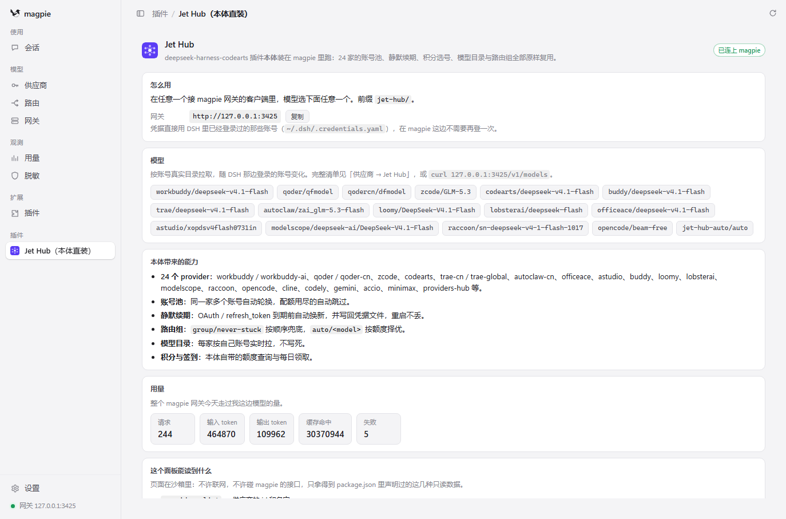

上图是 magpie 侧栏里的实拍（默认打开的「接入」标签，页面小标题写的是「接入点」）：
控制台端口 `18500`、模型 `892` 个。这两个数不是拍照时的巧合 —— 它们就是
`page/models.js` 快照里的 `consolePort` 与 `total`，所以**快照一变这张图就该重拍**，
否则图上显示的是旧端口、旧模型数。

### 六个标签

| 标签 | 内容 | 数据来源 |
|---|---|---|
| 接入 | 网关地址、模型前缀、curl/Python/Node/DSH 四种客户端片段（可复制） | 快照 + 本地常量 |
| 模型 | 按 provider 分组的全部模型 ID，可搜索 / 全部展开 / 复制全部 | `page/models.js` 快照 |
| 用量 | 今天 / 近 7 天 / 近 30 天的请求、失败、输入输出 token、缓存命中、费用，及前 20 个模型明细 | `magpie.read('usage:summary')` 实时 |
| 供应商 | 本体带来的全部 provider，标出哪些有模型、各几个 | 快照 + `providers:list` 实时 |
| 设置 | 默认模型、用量默认周期、复制是否带前缀（存 `plugins.json`，只属本插件） | `magpie.options` |
| 控制台 | 本地控制台地址（一键复制）+ 能在里面做什么的清单 | 本地常量 |

（侧栏页这六个标签是**只读**的概览；所有写操作在下面说的本地控制台里。）

### 控制台：完整功能走本地服务

页面只能**只读**（`providers:list` + `usage:summary`），这是 magpie 写死的：
受管页面的 CSP 是 `sandbox allow-scripts` + `connect-src 'none'` + `frame-src 'none'`
（见官方 `docs/subsystems/plugin-runtime.md`），页面既发不出请求，也嵌不进 iframe，
更没有调用插件的写入口（`magpie.actions` 只是往页面里 `postMessage` 菜单事件）。

所以**登录 / 换号 / 续期 / 积分领取 / 模型开关 / 账号池 / 备份导入导出**都在插件自己的
本地控制台里做 —— 那是一个真 HTTP 服务，浏览器打开即可：

```
http://127.0.0.1:18500/          # 默认端口，被占用自动 +1
```

> 一条限制先说清：供应商页里的账号行在 magpie 里是**只读展示** —— 挑某一行
> **不会**改变实际用哪个账号（本体网关没有按请求指定账号的入口，见上面
> 「账号也按 provider 分开」那段），换号要用本控制台「账号」标签的停用 / 启用 / 排序。

准确地址写在 `~/.config/magpie/jet-hub-console.json` 的 `url` 字段 —— 但**只有拿到首发端口
18500 的那个宿主会写它**（2026-10-28 起；因为 18500 被占而漂移到 18501+ 的实例不再覆盖它，
首发端口被别人占着，那个人才是所有者；测试起的临时实例带 `JET_HUB_NO_ADDR_FILE=1` 也完全不写）。
所以这个文件记的**永远是 18500 那台**的地址，漂移过的实例不在里面；所有者进程退出后文件
仍指向它，直到下次有实例拿到 18500 才刷新 —— 读取方本来就另有探活退路
（`scripts/shot-console.cjs`、`scripts/snapshot-models.mjs` 都沿 18500..18509 逐个验活）。
侧栏页面的「控制台」标签就是把这个地址摆出来，附一键复制。

⚠️ 侧栏页 CSP 是 `connect-src 'none'`，**它自己问不到端口**，所以地址是
`scripts/snapshot-models.mjs` 一起写进 `page/models.js` 的 `console` 字段 ——
端口变了要重跑一次快照，否则页面还显示旧端口（会连到别的实例上）。

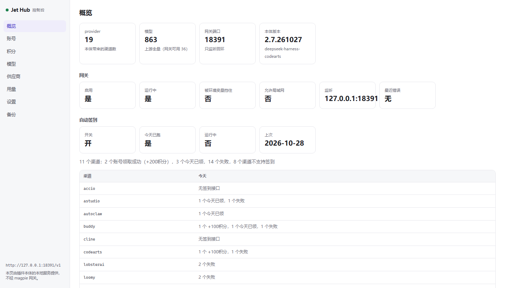

控制台背后的 RPC 端点（`POST /api/jet-hub`，`{type:"client-request",method:"jet-hub",payload:{method,payload}}`，
响应 `{result:{ok:true,value}}` / `{result:{ok:false,error}}`）。

控制台是八个标签的管理界面，覆盖本体可调度的 RPC —— **覆盖率与方法总数不写进本文**：
由 `tests/t-rpc-cover.mjs` 从源码解析后自动统计（主 `switch` 与前缀改道两批都算进去），
两个数随代码走，写死在文档里必然过期：

| 标签 | 能做什么 |
|---|---|
| 概览 | 本体/网关/模型/账号统计，网关六项状态（启用 / 运行中 / 被环境变量挡住 / 允许局域网 / 监听 / 最近错误），自动签到今日情况，provider 清单，接入代码 |
| 账号 | 每个 provider 的账号池：登录、续期、测试、复测、重置、新人奖励、补偿、上下移、删除、批量复测/重置，以及 per-账号的**出口代理**（见下） |
| 积分 | 状态 / 余额 / 徽章 / 全部领取；每日签到（含**每个有账号的渠道**的今日结果）；Cline 额度与请求流水；OfficeAce 状态；**永久积分锁定** |
| 模型 | 模型开关（单条 / 勾选批量 / 全开全关 / 清理失效）；聚合路由的候选目录、排序模式、到期排序、当前渠道、拒绝表，以及**候选级逐个打开/拒绝/调序** |
| 供应商 | 全部 provider 的模型数/账号数/启用状态、逐个停用启用、顺序保存 |
| 用量 | token 账本（6 项汇总 + 明细）、历史、删除某天、徽章偏好 |
| 设置 | 网关启用、局域网、渠道原生搜索、面板入口、MiniMax XFF、验证码三件套 |
| 备份 | 账号总数/缺有效期统计、导出下载、merge/replace 导入 |

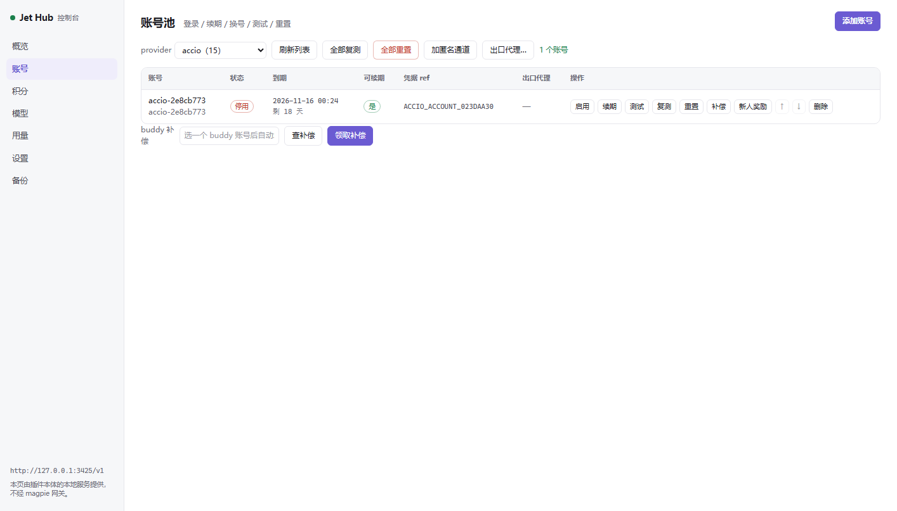
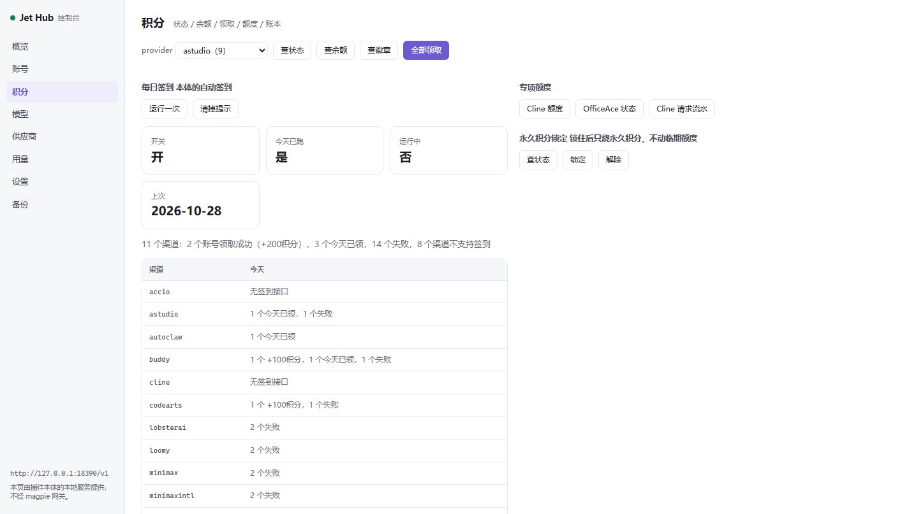
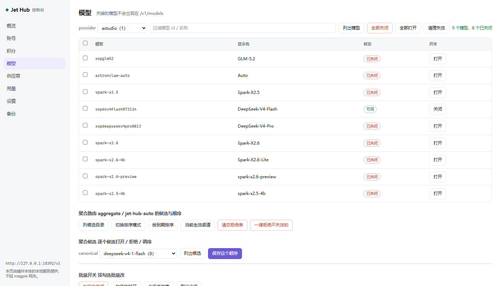
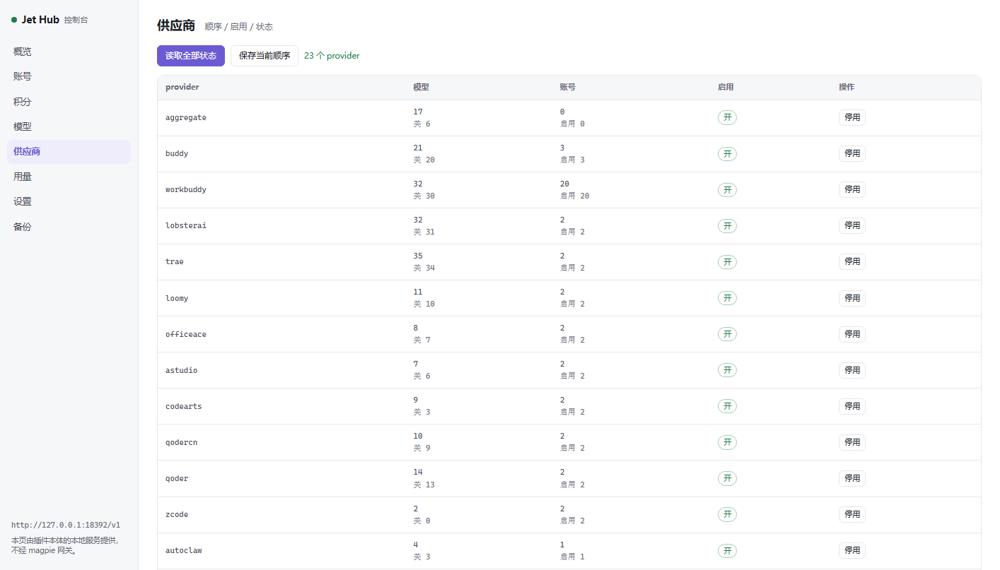
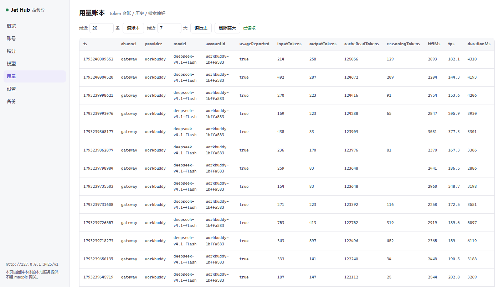
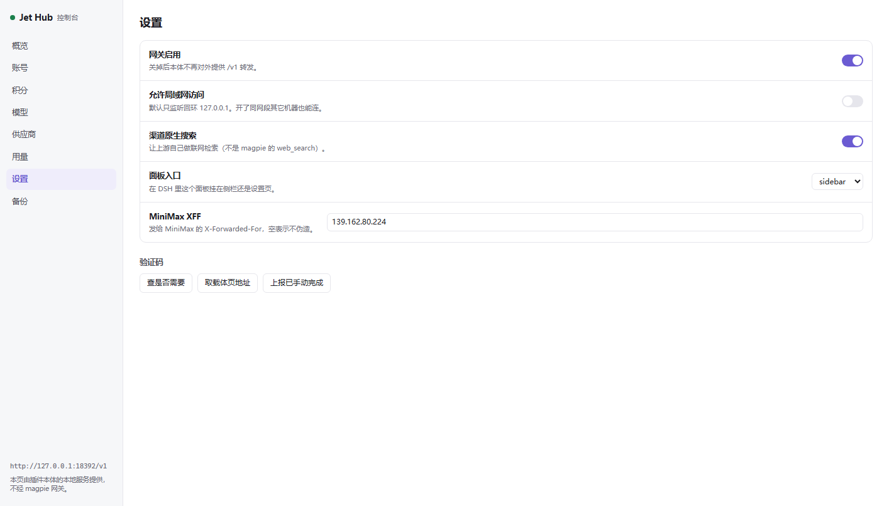
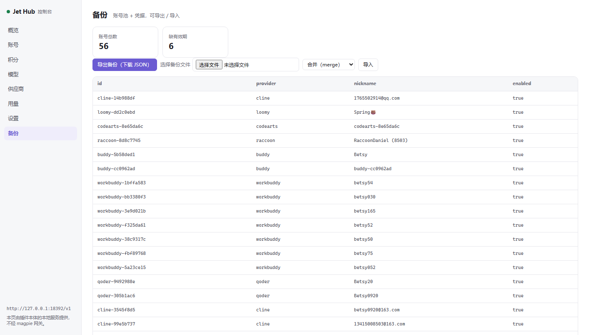

（八张按标签顺序排，概览那张在本节开头。全部由 `scripts/shot-console.cjs` 直接
覆盖写同一个文件名，所以重拍不需要改 README。）

三个**格式陷阱**（都实测踩过，本体不会报错，只会静默做错事）：

1. `aggregate.setOrder` 的条目是 `provider\u0000realId`（**NUL 分隔**），不是 `provider/realId`。
   传斜杠会被 `setAggregateOrder` 全部丢弃 → 返回空数组 → 顺手删键（等于清空手工顺序）。
2. `usage.autoCheckin` 的 `channels` 形状是 `{provider, text}`（`text` 是「1 个 +100积分，1 个失败」这类
   一句话），不是 `{enabled, lastDate, lastResult}`。按后者读会渲染出一整列空。
3. `account.resetAll` / `account.retestAll` / `buddy.compensationStatus` / `buddy.claimCompensation` /
   `cline.requestLog` / `onboarding.*` 都**必须**带 `accountId`（本体在守卫之后才解析凭据）。

改完控制台后跑一次 `node scripts/shot-console.cjs`：它用 Edge headless + CDP 逐个点开八个标签、
断言表格行数/卡片数/按钮数/错误消息，并把每页截到 `docs/console-<tab>.png`。
`node scripts/run-console.mjs` 则单独起一个容器 + 控制台（不重启 magpie），打印 `CONSOLE_URL`。

#### 两家 Key 型渠道加账号走各自的 `*.addAccount`

`modelscope` 和 `opencode` 没有浏览器授权流程，**本体不接受 `account.create`** ——
传 `provider:'modelscope'` / `'opencode'` 会回 `unknown provider: xxx`
（`vendor/lib/jet-hub-rpc.js:4384`）。本体官方客户端自己也是这么处理的：
`vendor/lib/client/jet-hub.js:8073`（opencode）与 `:8077`（modelscope）在
`createAccount()` 里提前弹 Key 输入框然后 `return`，根本走不到 `account.create`。

所以控制台对这两家换了入口（`console/console.js:389` 的 `KEY_CHANNELS`）：

| 渠道 | 走的 RPC | Key 形状（与本体报错文案同源） | 取 Key 的地方 |
|---|---|---|---|
| modelscope | `modelscope.addAccount` | 以 `ms-` 开头、至少 20 位（`vendor/lib/modelscope-rpc.js:88`） | https://modelscope.cn/my/myaccesstoken |
| opencode | `opencode.addAccount` | 20 位以上、不含空格的密钥串（`vendor/lib/opencode-rpc.js:251`） | https://opencode.ai/console/account |

同一把 Key 重复添加会复用同一条账号，不会建出两条（modelscope 在
`vendor/lib/modelscope-rpc.js:95` / opencode 在 `vendor/lib/opencode-rpc.js:276`
回 `existed: true`）。控制台只填自己的入口，没去改 `src/` 给 `account.create`
长一个没有轮询的 create 分支 —— 那要把两份 `KEY_PATTERN` 校验也复制一遍
（理由写在 `console/console.js:373-388` 的注释里）。

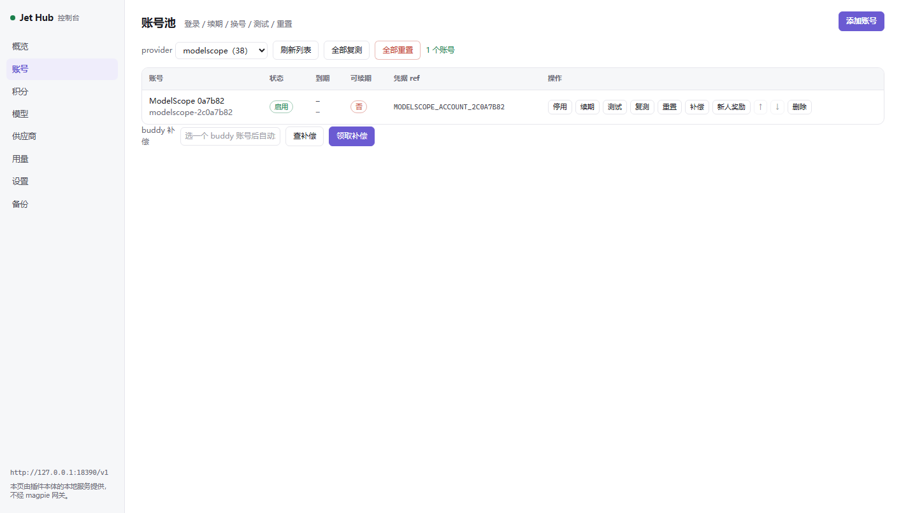
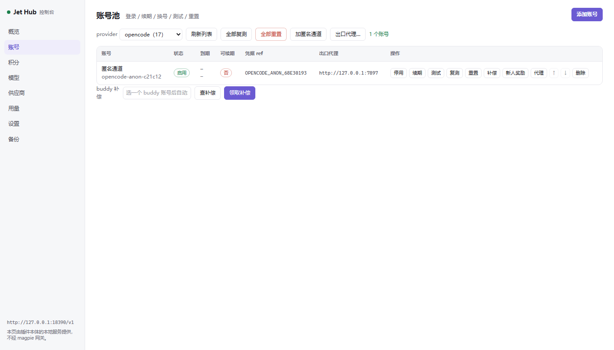

#### 出口代理也是 per-账号，四家四份实现

控制台不把四家的代理合成一个输入框（`console/console.js:561` 的 `PROXY_CHANNELS`）：
本体那边就是**四个池字段、四份 setProxy**（`vendor/lib/account-pool.js:2705`
`setOpencodeProxy` / `:2737` `setGeminiProxy` / `:2778` `setQoderProxy` / `:2816`
`setMinimaxIntlProxy`），语义各不相同 —— opencode 是按出口 IP 分份额度、Gemini 是
能不能连通（端点全在墙外）、Qoder 是绕 SNI 阻断、MiniMax 国际站是绕地域分流。
合并成一个就会「清掉 Gemini 的代理顺手清掉 opencode 的出口配置」。


读代理**不需要新 RPC**：`account.list` 的 `listAccounts` 只做浅拷贝
（`vendor/lib/account-pool.js:1601` 的 `{ ...entry }`），池字段原样透传，弹窗打开时
就拿这条值回填输入框。写走各家 `*.setProxy`，**空串 = 删键回直连**
（`account-pool.js:2715` / `:2747` / `:2788` / `:2826` 的 `delete entry.xxxProxy`），
不是写空串 —— 否则下游会把空串当成「配了一个空地址」。

两处入口上的坑：

- `qodercn` **没有自己的** `qodercn.setProxy`：前缀改道只认 `qoder.`
  （`vendor/lib/jet-hub-rpc.js:2936`，而 `'qodercn.setProxy'.startsWith('qoder.')` 为 false）。
  但 `setQoderProxy` 是按 `accountId` 定位的，中国版账号照样能设；只有「测试连接」
  得把 `provider` 传 `qodercn` 才会选到中国站产品（`vendor/lib/qoder-rpc.js:56` 的 `productOf`）。
- 代理串必须**带显式端口**且协议是 http/https/socks5（`vendor/lib/opencode.js:121`
  `normalizeProxy`）：裸 `host:port` 会补成 `http://`，`socks5h://` 归一成 `socks5://`，
  `ftp://…` 直接回「不支持的协议」（`shot-console.cjs` 的代理断言就是用 `ftp://host:21`
  这种必被拒的串，错误路径不落池字段，跑多少遍都不污染账号池）。

「测试连接」只收 `{proxy}`（qoder 另收 `provider`），**不收 `accountId`** —— 它测的是
「这个出口通不通」，与哪个账号无关。四家的回包形状也不同，别硬套一套文案：
opencode 回出口 IP + 国家 + 延迟（`opencode-rpc.js:394` 的 `exitIp`，10 秒超时），Gemini / Qoder
只看拿没拿到 HTTP 响应（400 / 401 / 403 同样证明链路通，不判状态码，15 秒超时），
MiniMax 国际站用 `redirect:'manual'` 看 307 那一跳判有没有被分流（`minimax-rpc.js:184`，
跟随之后 401 与「凭据失效」逐字同形，事后分不清）。

### 两个必须记住的渲染事实

1. **模型目录拿不到实时值**。页面 `connect-src 'none'`，`providers:list` 只给
   `{id, name}` 不给模型。所以模型清单是**快照**：`scripts/snapshot-models.mjs`
   从 magpie 网关 `http://127.0.0.1:3425/v1/models`（或运行中控制台的
   `getCachedCatalog`）读一次，写成 `page/models.js`。换账号/加模型后重跑一次
   即可（页面上会显示快照时间，不假装实时）。
2. **页面是 OOPIF，主文档读不到它的 DOM**。`sandbox="allow-scripts"`（没有
   `allow-same-origin`）⇒ opaque origin ⇒ 独立进程。所以 `ui-check.cjs`
   不能从主窗口 `contentWindow` 进去，而是从 `/json/list` 里找 `type=iframe`
   那个目标、直连它自己的 `webSocketDebuggerUrl`。这一点踩过：在主 target 的
   `Runtime.executionContextCreated` 里永远只看得到 2 个上下文，抓不到页面。

## 入口只导出插件工厂

`index.mjs` 只导出 24 个 `JetHub*Plugin`，一个都不多。

> ⚠️ **绝不能多导出常量/工具函数**。magpie 宿主加载插件时遍历**全部导出**并
> 探测性调用，任何一个非插件工厂的导出都会让它抛错、整个插件加载失败
> （`plugin list` 报 failed）—— 实测过一次：多导出 `DISPLAY_NAME` /
> `PROVIDER_IDS` 之类的常量对象就会炸。所以常量表都留在 `src/plugin.mjs`，
> 需要单测内部函数请直接 import 那里。

## 测试

```bash
# 一把梭：跑全部不需要环境的单测（退出码即结论）
node scripts/test-all.mjs

# 连环境的一起跑（要 magpie 3425 与 web 3456 都在）
node scripts/test-all.mjs --all
```

逐项：

```bash
# 插件契约全链路（模拟宿主探测 → config → authorize → models → 真转发）
"C:/Users/Betsy/.cache/magpie/bun/1.4.4/magpie-bun.exe" tests/t-plugin.mjs

# models() 不阻塞（必须 < 2s，否则会被 magpie 的 20s 超时打断）
"C:/Users/Betsy/.cache/magpie/bun/1.4.4/magpie-bun.exe" tests/t-models-nowait.mjs

# 死号过滤判据（13 条断言，不联网）
"C:/Users/Betsy/.cache/magpie/bun/1.4.4/magpie-bun.exe" tests/t-dead-account.mjs

# .credentials.yaml 写回不吞行（14 条断言，不联网）
"C:/Users/Betsy/.cache/magpie/bun/1.4.4/magpie-bun.exe" tests/t-writerefs.mjs

# 经 magpie 网关 3425 真转发（非流式 / 流式 / 工具调用 / 路由组）
python tests/t-gateway.py

# 界面自检（CDP 驱动 Edge → 点侧栏 → 连进页面 OOPIF → 六个标签逐个截图 + DOM 断言 + 收集 JS 报错）
MAGPIE_WEB_KEY=<key> node tests/ui-check.cjs
# 截图落在 %TEMP%/jethub-ui/tab-*.png；有 JS 报错或标签没渲染就退出码非 0
```

测试用 magpie 自带的 bun（`~/.cache/magpie/bun/*/magpie-bun.exe`），因为宿主就是 bun。

### 需要 magpie web 登录 key 的三个脚本

`tests/ui-check.cjs`、`scripts/shot-console.cjs`、`scripts/shot-usage.cjs` 都要用 magpie
web 的登录 key。**key 一律从环境变量 `MAGPIE_WEB_KEY` 取，代码里不写默认值。**

```bash
MAGPIE_WEB_KEY=<key> node tests/ui-check.cjs
MAGPIE_WEB_KEY=<key> node scripts/shot-console.cjs
MAGPIE_WEB_KEY=<key> node scripts/shot-usage.cjs
```

key 在启动 web 实例时打印出来：

```
● magpie web on http://127.0.0.1:3456/?k=<key>
```

没设 `MAGPIE_WEB_KEY` 时这三个脚本**直接退出码 2**，不会静默用一个内置值去连 ——
那是 2026-10-28 修掉的真实问题（内置 key 随仓库公开了，见
[`VERIFICATION.md`](VERIFICATION.md) 第十九节）。`ui-check` / `shot` 也仍接受把 key
作为第一个位置参数传入（旧用法），但别把它写进任何脚本或文档。

## 已知限制

- 账号自身的额度/refresh token 过期与本插件无关：`officeace` 等会报
  `STS5.1806 invalid refresh token: 'the refresh token has been used'`，
  需要在 DSH 里重新登录（refresh token 是一次性的，这是上游设计）。
- **死号会拖垮整个渠道**：本体的选号只看 `enabled` 与限流，不看 `expiresAt` /
  `refreshable`，所以「已过期且不可续期」的账号一旦排在手动顺序前面，每次请求
  都会撞 502，而健康账号其实可用。本插件在容器层过滤掉这类死号
  （`src/container.mjs` 的 `_filterDeadAccounts`，详见 `VERIFICATION.md` 第七点五节）。
  注意：过滤只让死号不参与选号，**不会删除**它 —— 彻底清掉请去 DSH 的 Jet Hub 删账号。
- `zcode` 可能报"上游并发限流"：本体自带退避，属上游限流，非插件缺陷。
- 本体的 Jet Hub **设置界面**（`lib/client/jet-hub.js`）是 DSH 的前端 UI，搬不过来；
  magpie 里由本插件自己的侧栏页 + 本地控制台替代 —— 登录、续期、停用 / 启用 / 换号都在
  本地控制台里做，**功能上不再需要回 DSH**；但**在 magpie 里挑账号行不算换号** ——
  那些行是只读展示，见上面「控制台：完整功能走本地服务」那一段的限制。
- 侧栏「模型」页是**快照**，不随账号变化自动更新；页面里显示的也是快照时间。
  真正的实时模型清单与控制台在本地 HTTP 服务里（`console/`）。
- 侧栏页能读的只有 `providers:list` 与 `usage:summary` 两项（magpie 的白名单，
  `connect-src 'none'` 写死），所以侧栏里做不出「点一下就登录/换号」的按钮；
  这类写操作全部在本地控制台（`http://127.0.0.1:18500/`）里。
- 控制台接了本体哪些可调度方法、哪些没接，以 `tests/t-rpc-cover.mjs` 的输出为准
  （本文不写死「接了多少 / 共多少」这两个数）。
  数这个数有几个坑，都踩过：只数小写首段会漏掉 `nativeSearch.*` / `panelEntry.*`
  这类驼峰首段；直接 grep 关键字面量会把 `claimed` / `inactive` / `failed` /
  `already-claimed` 这四条非 RPC 的枚举 case 算进去；在控制台里
  `grep rpc('...')` 会漏掉**以字符串常量传入**的调用 —— `account.resetAll` /
  `account.retestAll` 就是这样接的（「全部重置」「全部复测」两个按钮把方法名当参数
  传给 `accBulk()`），它们是真接了的，别当成未接。
- 方法总数也不是主 `switch (method)` 的 case 标签数：另有一批方法**根本不走主
  switch**，在它之前先被 `handleMethod()` 按 `opencode.` / `gemini.` / `qoder.` /
  `minimaxintl.` / `modelscope.` 五个前缀改道接管。按 case 扫会整体漏掉这一批
  （这几家的账号级代理、匿名账号、指定 provider 加号等入口都在里面）。
- `loomy.permanentLock` 与 `credits.permanentLock` 是同一实现的**两个 label**，
  传 `provider:'loomy'` 走哪个名字都行（实测回包一致）。控制台用的是变量而非常量：
  `console/console.js` 的 `lockAction()` 里 `const lockMethod = provider === 'loomy' ?
  'loomy.permanentLock' : 'credits.permanentLock'`，load / on / off 三个 mode 都走它。

## 供应商编辑器里的开关（`auth.options`）

magpie 的 auth 契约允许插件声明若干开关，用户在「供应商 → 高级」里拨，插件在
需要时现读（`input.magpie.option(provider, key)`，**不重启就生效**）。本插件声明两个：

| key | 默认 | 打开 | 关掉 |
|---|---|---|---|
| `prefer_full` | 开 | 模型列表用上游全量（含已关闭） | 只列网关此刻可用的模型 |
| `dead_account_skip` | 开 | 已过期且 `refreshable=false` 的账号不参与选号 | 死号也参与（会 502） |

两个开关都不是装饰：`prefer_full` 直接决定 `provider.models()` 走全量还是走实时
（实测 workbuddy 全量开 32 个、关掉 2 个）；`dead_account_skip` 直接决定容器层
`_filterDeadAccounts` 的取舍。`tests/t-options.mjs` 用两份不同的 `input.magpie`
各建一次插件实例来验证这一点，而不是只断言字段存在。

`auth.icon` 是内联 SVG 的 `data:image/svg+xml;base64,…`（不依赖外部图床），
magpie 落盘成 `file:<hash>.svg` 供 GUI 引用。

## 模型能力（上下文 / 支持图片 / 推理强度）

magpie 模型列表里那三列**只能由插件的 `provider.models()` 给**：宿主拿到钩子返回后
是**整体替换**（`out.models = Object.fromEntries(...)`，见宿主 `host-*.js` 的
`info()`），**不跟 models.dev 的 capabilities 合并** —— 少给一个字段，界面上那一格
就是空的（推理档位显示「跟随分组推理」、没有图片标记、上下文一排 128K）。

数据来自本体 `ctx.llm`，但**分在两处**，只读前一处等于没读：

| 字段 | 来源 | 备注 |
|---|---|---|
| `limit.context` | `resolveModelInfo().context.contextWindow` | `listModels()` **不带**窗口 |
| `limit.output` | `resolveModelInfo().defaultMaxTokens` | |
| `capabilities.input.image` | `resolveModelInfo().inputModalities` | 决定「支持图片」标记 |
| `capabilities.reasoning` | `resolveModelInfo().reasoning.efforts` | 决定推理档位 |
| 模型名 / 是否已关闭 | `listModels()` / `model.list` RPC | |

实测（2026-10-29，用户报「推理强度 / 支持图片输出 / 上下文没正确取到」）：只读
`listModels()` 时**53 个模型里 0 个有窗口**，界面 53 行全显示 128K，而真窗口是
1M。补齐后 `trae/deepseek-v4.1-flash` = `context 1000000 / output 64000 /
image true / reasoning true`，`astudio/xopdsv4flash0731in` = `1048576 / 100000 /
纯文本`。

上游全量目录（895 条）走完 `model.list` RPC 后同样逐条 `resolveModelInfo` 补：
**实测 300 条 8 ms**（读的是适配器已缓存的目录，不发网络请求），41% 能解析出窗口。
`codely` 那家上游只声明模态、不声明窗口，所以它的 `limit.context` 仍是 0 —— 上游
事实，不是插件缺陷（`tests/t-plugin.mjs` 因此只把「一家都没有」判成失败）。

能力元数据跟目录一起落盘到 `~/.config/magpie/jet-hub-models.json` 的 `meta` 字段，
冷启动首屏就有真窗口，不必等本体 20–30 秒起来。

## 图片（附件服务 `src/attachments.mjs`）

**纯文本一直好、一发图就 400「当前 profile 未装载附件服务（@deepseek-ai/dsh-attachment-local），无法接收图片」**。
这不是 DSH 环境缺包 —— 那句话出自本项目 vendor 的本体，触发点是自己人：

```js
// src/llm-bridge.mjs（改之前）
toGenerateOptions(body, signal, reasoningEffort, maxTokens, {})   // ← 第 5 参空桥
```

本体的图片**收发都只走 `ctx.attachments`**（入站 `images.js:toImageBlock` 调
`bridge.saveImage`，出站 `index.js:makeReadImage` 调 `attachments.readImage`），而
magpie 的宿主**不提供**这个服务，所以插件得自己实现一个再 `ctx.provide`。

契约（`vendor/lib` 实测，不是猜的）：

| 方向 | 插件要提供 | 返回 |
|---|---|---|
| 入站：客户端 → 本体 | `saveImage({ data: Uint8Array, mediaType })` | `{ attachmentId, mediaType, width, height, bytes }` |
| 出站：本体 → 上游 | `readImage(ref, signal?)` | `{ data, ref: { mediaType, … } }` ← **必须是 `ref.mediaType`，不是顶层 `mediaType`** |
| 出站可选 | `readImageRequest()` | 直接返回 `undefined`（见下） |

- **`attachmentId` 是内容寻址的 `sha256:<64hex>`**，落盘 `<dir>/objects/<hash>.<ext>`
  加一份同名 `.json` 元数据（先写 `.tmp-*` 再 rename）。同一张图二次落盘直接复用元数据，
  `objects/` 不会越存越多。`readImage` 会**重算 sha256 对账**，被改过就抛
  `ATTACHMENT_CORRUPTED` 而不是把坏字节发给上游。
- **尺寸自己解析头部**（PNG / JPEG / GIF / WebP 三种子格式），不引 `sharp` 之类的原生
  依赖 —— 插件要能在一个没编译工具链的机器上直接跑。测试覆盖六种头部的真值尺寸。
- **限额与本体同源**（20 MB / 单条 20 张 / 8192 px / png·jpeg·webp·gif）。两边不一致会
  出现最难受的一种错：本体放行、插件拒绝。
- **不做缩放**：`readImageRequest` 永远返回 `undefined`，本体自己有回退路径（拿不到就发
  原图）。要缩放就得引 sharp，代价大于收益。
- **只收 data URL**：`http(s)` 外链由本体自己拒（防 SSRF），插件不用管。
- 附件目录：`JET_HUB_ATTACHMENT_DIR`，默认 `~/.config/magpie/jet-hub-attachments`。
- 必须**在 `ctx.plugin(mod)` 之前** `ctx.provide('attachments', …)`：本体的
  `makeReadImage(ctx)` 在 apply 时把服务闭包捕获一次，晚一步就永远是 `undefined`。

回归守卫两处：`tests/t-attachments.mjs`（单测 + 与本体真实对接，含「无桥必须抛那句话」）、
`tests/t-direct.mjs` 的「3.5) 图片入站」（真容器真上游发一张图，断言不再报附件错、图真落盘）。

## 供应商图标（`src/icons.mjs`）

**每家一个图标**，不是 24 个 provider 共用插件自己那个。三种来源：

| 来源 | 用在哪 |
|---|---|
| magpie 本体内嵌的 `assets/icons/*.svg` | 有厂商的渠道：Trae / Qoder / Cline / Gemini / MiniMax / ModelScope / OpenCode / 智谱（AutoClaw）/ 阿里（Accio）/ 讯飞（AStudio）/ 华为云（CodeArts） |
| 厂商自己出的位图 | ZCode —— 只有官方 PNG（`src/zcode-icon.mjs` 内联，128×128）；WorkBuddy —— LobeHub 图标库的 `workbuddy-color.svg`（和 magpie 内嵌的那张同图） |
| 现画 | 没有对应厂商的：聚合路由、自动选号、Buddy、Codely、LobsterAI、Loomy、Raccoon、OfficeAce |

用 magpie 那套图是有意的：它给自己的内置供应商显示的就是同一套 logo，
所以插件渠道和 magpie 自带渠道在列表里视觉一致。`*intl`（AutoClaw 国际 /
MiniMax 国际 / Qoder 国内）在原 logo 外面套一圈虚线地球环 —— 同一家的两个
端点要能一眼分开，又不能让人以为是两个品牌。

授权：品牌 logo 的商标归各家所有，这里只用于标识对应的服务，不声称任何
关联或背书。要用自己的图标改 `src/icons.mjs` 里的 `PROVIDER_SVG` 即可。

`tests/t-options.mjs` 会断言 24 个 provider 的图标**互不相同**（这条是回归守卫：
曾经 24 个全是同一个六向星，光看测试是绿的）。

## 目录

```
index.mjs              入口，只导插件契约
src/plugin.mjs         插件工厂：config / auth / provider
src/container.mjs      内嵌 cordis 容器，加载本体并转发
src/credentials.mjs    把 .credentials.yaml 桥成 credentials 服务
src/connection.mjs     补 connection 服务，让本体的 jet-hub-rpc 端点注册起来
src/attachments.mjs    附件服务：本体的图片收发都走 ctx.attachments，宿主不提供，插件自己实现
src/hub-server.mjs     本地控制台 HTTP 服务（静态页 + /__meta + /api/jet-hub）
vendor/                本体（deepseek-harness-codearts 2.7.261027 的 lib/ + locale/ + 上游 LICENSE）
page/                  侧栏页面（index.html / page.js / page.css / models.js 快照 / icon.svg）
console/               控制台界面（八个标签，RPC 覆盖率见 tests/t-rpc-cover.mjs）
scripts/seed-auth.mjs  把本体账号池按 provider 摊平写进 magpie 的签入记录
scripts/snapshot-models.mjs  重新生成 page/models.js
scripts/shot-console.cjs     控制台八标签实拍 + DOM 断言（Edge headless + CDP）
scripts/shot-usage.cjs       用量页账号积分卡片实拍（需 MAGPIE_WEB_KEY）
scripts/run-console.mjs      单独起容器 + 控制台，不重启 magpie
scripts/test-all.mjs   测试总入口
tests/                 验证脚本（t-plugin / t-models-nowait / t-dead-account / t-writerefs / t-usage / t-checkin / t-options / t-attachments / t-seed-auth / t-console / t-direct / t-gateway / t-rpc-cover / ui-check）
LICENSE                本插件自己的 MIT（与 vendor/LICENSE 是两份，别混看）
vendor/LICENSE         上游 deepseek-harness-codearts 的 MIT，随 vendor/ 一起分发
docs/screenshot.png    侧栏页面实拍（`tests/ui-check.cjs` 的截图）
docs/console-*.png     控制台实拍：八标签 + Key / 代理两个弹窗（`scripts/shot-console.cjs` 直接覆盖写）
docs/archive/          不再被 README 引用的旧截图留档
```

## 实现细节补充

- **没有内嵌网关**（本次改动）：本体的 OpenAI 兼容网关只是 `ctx.llm` 的一层
  HTTP 外壳，而插件在同一个进程里已经握着 `ctx.llm`。所以容器显式
  `DSH_OPENAI_GATEWAY_ENABLED=0`，请求由 `src/llm-bridge.mjs` 在**进程内**直接
  交给本体 llm 服务 —— 不占端口、不需要随机 apiKey、不需要等网关就绪。
- 凭据桥是 **双向** 的：本体 refresh 出的新 token 会原子写回
  `~/.dsh/.credentials.yaml`（临时文件 + `rename` + `.bak`），所以在 magpie 里
  用过之后，DSH 侧也是最新的。
- 控制台端口从 `18500` 起动态探测，只有拿到首发端口 18500 的那个宿主会把实际 `url`
  写入 `~/.config/magpie/jet-hub-console.json`（漂移过的实例不写）；控制台只监听
  回环地址。magpie 侧的对外入口统一是它的网关 `http://127.0.0.1:3425/v1`。
- 上面这个对外网关地址**写的是默认值**。magpie 不把它的端口落盘到任何可读配置
  （`~/.config/magpie/` 下没有网关命名文件，`settings.json` 也没有端口键），宿主
  注入插件的环境变量只有 `MAGPIE_*` 系列、同样不带端口，所以插件无法自动探测。
  换过端口的话，用环境变量覆盖即可，控制台、插件页、快照脚本三处会一起跟着变：

  ```bash
  export JET_HUB_USER_GATEWAY=http://127.0.0.1:4000
  ```

  真源是 `src/container.mjs` 的 `DEFAULT_USER_GATEWAY`，经 `meta().gateway.userGateway`
  下发给控制台与 `scripts/snapshot-models.mjs`；`page/page.js` 与 `page/index.html`
  里各留一份兜底常量，只在快照还没生成时显示。

