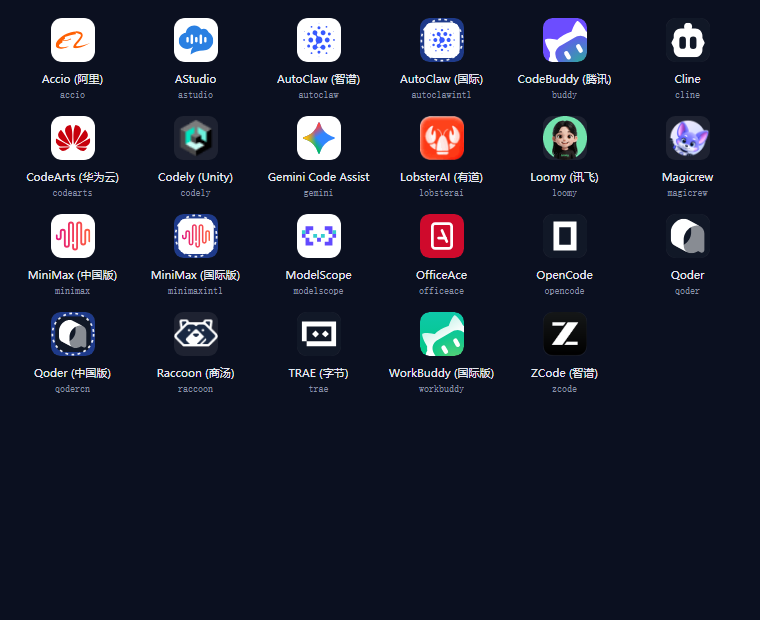

# magpie-jet-hub

[](https://github.com/Betsy20/magpie-Jet-Hub)

把 **deepseek-harness-codearts 插件本体**装进 magpie。

> **上游插件**：[`iJetLi/dsh-providers-hub`](https://github.com/iJetLi/dsh-providers-hub)
> （MIT）。它给 DSH 提供 23 家 AI 编码供应商的账号登录、多账号池、静默续期、
> 积分领取和一个本地 OpenAI 兼容网关。本仓库**不是它的分支、也不修改它** ——
> 只把它的发布产物装进 [`vendor/`](vendor/)（两处规避扫描器的写法差异见
> [下文](<#vendor-的来源与许可>)），让 magpie 能直接用同一批
> 账号和同一套能力。遇到供应商适配、登录流程、续期算法本身的问题，去上游提；
> 本仓库只负责「装进 magpie」这一层（见[为什么这么做](#为什么这么做)）。

不是"重写一份 CodeArts 能力"（那样只搬一家），而是把本体「路由中枢」原样跑起来：
内嵌一个 cordis 容器加载 [`deepseek-harness-codearts`](https://github.com/iJetLi/dsh-providers-hub)（= `dsh-providers-hub`，其中 25 个 provider，本插件接入其中 23 个真渠道），
让它自己开一个只监听回环的 OpenAI 兼容网关，magpie 侧只把请求转发进去。

```
magpie 网关 (3425)
  └─ provider `jet-hub-*` ×23      ← 本插件（每家一个供应商）
       └─ auth.loader().fetch       ← 只改这一层：剥 provider 前缀 + 转发
            └─ JetHubContainer（内嵌 cordis + 本体 lib/index.js）
                 └─ 本体自带网关 127.0.0.1:<动态端口>
                      └─ 23 家 provider 的真实上游
```

## 模型目录：上游全量，不是「当前可用」

这里有两套目录，**不要混用**。下表三个 provider 是**对照样本**（只说明「网关只给
此刻能用的、全量多得多」这个量级差，不是权威计数）。权威家数/条数只看快照
`page/models.js` 的 `providers` 与 `total`：

| 来源 | 含义 | astudio | cline | workbuddy |
|---|---|---|---|---|
| 网关 `/v1/models` | 此刻**能用**的 | 1 | 1 | 2 |
| 本体 `model.list` RPC | 上游**全量** | 9 | 542 | 32 |

magpie 里 `jet-hub-*` 每个 provider 的模型列表用的是**后者**（全量），因为用户要的是
「供应商上游全部模型」。家数与条数**不在这里写死** —— 以快照为准：`page/models.js`
的 `providers` 键有多少就是多少家，`total` 是多少就是多少条（快照每次重生成都会变，
本文件里凡是写具体数字的地方都标明它出自哪次快照或哪次现测）。全量里已在 Jet Hub
关闭的模型照样列出，名字后缀 `· 已在 Jet Hub 关闭`、页面里显示为灰，提示你到 magpie 的
「Providers」编辑器里把它打开（控制台 2026-10-31 起不再提供模型开关）。

取数链路：

```
插件进程（bun）  容器启动 → 网关 /v1/models（可用）+ model.list RPC（全量）
                 ↓ 落盘 ~/.config/magpie/jet-hub-models.json  { at, models, full }
magpie 宿主      provider.models() / config().models 同步读盘 → 立刻返回，不阻塞
页面            node scripts/snapshot-models.mjs 读同一份盘 → page/models.js
```

为什么要落盘：magpie 给 `provider.models` 的超时是 20 秒，而本体冷启动 + 拉全量
要 20–40 秒；直接 await 必然超时，只能「先给上次的、后台再刷」。

⚠️ `writeCache` 只写**有值**的那一份。全量要 20+ 秒才到，若先到的实时目录把
`full: undefined` 写进去，会把上一次落盘的全量覆盖掉（踩过：缓存被写成只剩 35 条）。

⚠️ 进程内缓存有 **60 秒 TTL**（`src/plugin.mjs` 的 `CACHE_TTL_MS`）。插件进程是常驻的，
若 `allModels` / `fullModels` 一旦有值就永不重读，你在别的进程刷新了盘上缓存，
常驻宿主仍报旧数字，直到 magpie 重启（踩过：`plugin list` 显示 cline 540，界面里仍是 1）。

刷新：`node scripts/snapshot-models.mjs`；上游上新模型后跑一次即可（页面与
`provider.models()` 会在 60 秒内跟上）。

## 为什么这么做

| 做法 | 结果 |
|---|---|
| 重写一份 CodeArts | 只能覆盖一家；本体的账号池、续期、选号、目录全丢 |
| 桥接 DSH 网关 8326 | 要先起 DSH 进程；本插件不依赖 DSH |
| **本插件：装本体** | 本体 23 家真渠道全在，升级跟着走，**不依赖 DSH 进程** |

代价：本体随 `vendor/` 分发（18 MB）。

### `vendor/` 的来源与许可

`vendor/` 目前是**上游源码的构建产物**：npm 上最新的 `2.9.261029` 之后上游又推了两条
提交（新增 `magicrew` 供应商），所以这一版不来自 npm 包，而是从
[`iJetLi/dsh-providers-hub`](https://github.com/iJetLi/dsh-providers-hub) 的
`6fa74723d42ff605d1de349589c21a1ac4eb7ba2` 克隆下来 `npm install`
（自动跑 `tsc -p tsconfig.json && node scripts/copy-assets.mjs && node plugin-src/client/build.mjs`）
构建出 `lib/`，再连同 `locale/` 拷进来。`package.json` 与 `LICENSE` 仍取 npm 2.9.261029
那一份（依赖与许可没变，见下）。

| 项 | 值 |
|---|---|
| 上游源码仓库 | [`iJetLi/dsh-providers-hub`](https://github.com/iJetLi/dsh-providers-hub) |
| npm 上的包名 | `deepseek-harness-codearts`（**同名同版本也发布在 `dsh-providers-hub` 与旧名 `dsh-codearts-auth` 下**，`lib/` 只差同一个包名字符串出现的那两处：`lib/client/jet-hub.js` 的 `id:` 与 `PLUGIN_ID`） |
| 版本 | `2.9.261029`（`vendor/package.json` 沿用 npm 2.9 那一份） |
| 代码对应 commit | `6fa74723d42ff605d1de349589c21a1ac4eb7ba2`（比 npm 2.9 多两条提交，含 `magicrew`） |
| 许可 | **MIT**，`Copyright (c) 2026 Jet` —— 全文见 [`vendor/LICENSE`](vendor/LICENSE) |
| 取法 | `git clone` 上游 → `npm install`（`prepare` 脚本负责构建）→ 拷 `lib/` `locale/` 进 `vendor/`；`package.json` `LICENSE` 用 `npm pack deepseek-harness-codearts@2.9.261029` 里那份 |

**包名演进**：上游 README 写明「本包原名 `dsh-codearts-auth`（`0.2.0-rc.11` 起改名）」，
改名后仓库/包名是 `dsh-providers-hub`；`deepseek-harness-codearts` 是另一个发布名
（上游 `lib/client/jet-hub.js` 里的 `PLUGIN_ID` 就是它）。三个名字在 npm 上**同版本
并存**，所以「上游」有三种找法 —— 读源码去 GitHub，装包/对版本去 npm 任一名字。

> **两个 GitHub 仓库，同一血统**：`dsh-providers-hub` 的 npm 元数据里 `repository`
> 写的是 [`zhuweiyou/dsh-providers-hub`](https://github.com/zhuweiyou/dsh-providers-hub)，
> 而本文与上游 README 都用 [`iJetLi/dsh-providers-hub`](https://github.com/iJetLi/dsh-providers-hub)。
> 实测（2026-10-30）：两边 master 分别是 zhuweiyou `758a20bc`（2026-10-25 停在这里）/
> iJetLi `6fa74723`（2026-10-30），`git merge-base` 返回 `758a20bc` 本身
> （`git merge-base --is-ancestor` 通过）⇒ iJetLi 那个仓库包含 zhuweiyou 的全部历史
> 并继续往前走，领先 39 个提交。看代码去 iJetLi（更新），查发布元数据会看到 zhuweiyou
> （`repository` / `homepage` / `bugs` 都指向它，而且只出现在**镜像** npmmirror 的
> packument 顶层，官方 registry 没有）。
>
> 元数据细节（`npm view` 实测，别把两个字段混成一句）：`author` 只有
> `dsh-providers-hub` 有（`zhuweiyou (https://github.com/zhuweiyou)`），我们实际用的
> `deepseek-harness-codearts` 与旧名 `dsh-codearts-auth` 的 `author` **都是空的**；
> 三个发布名的 `maintainers` 都是 `weiyou <i@zhuweiyou.com>`（名字是 `weiyou`，
> 不是 `zhuweiyou`）。且 `repository` / `author` 只在镜像（npmmirror）的 packument 里，
> 官方 registry 的 packument 与 tarball 内的 `package.json` 都没有这两个字段。

**与上游构建产物的实际差异**（2026-10-30 逐文件 `sha256` 比对过，别信「原样」两个字）：

| 差异 | 原因 |
|---|---|
| `lib/gemini-oauth.js` 与 `.d.ts` 里两个默认 OAuth client 常量拆成两段字符串拼接 | 规避 GitHub push protection 误报；**值完全相等**（`node` 实测两个常量 `===`，长度 73 / 35 字符都一致），行为不变，另有环境变量可覆盖。唯一的边缘副作用：`.d.ts` 是声明文件，`declare const` 的初始值按 TS 规范只能是字面量，拼接写法在**单文件 `tsc file.d.ts`** 时会报两条 `TS1254`（上游原版 0 条）—— 本仓库不编译类型声明、`types` 入口 `lib/types/index.d.ts` 上游本就缺失，正常使用路径不受影响 |
| `lib/magicrew-browser-login.js` 与 `lib/magicrew-local-browser.js` 补读 IndexedDB | 上游这两处只从 `localStorage` 找登录凭剧，而超级麦吉网页版把凭据写在 IndexedDB 的 `magic-global/user` 库里 —— 真机上「登录成功却永远读不到」。详见上文「超级麦吉的登录凭据在 IndexedDB 里」。**行为只增不减**：localStorage 那条老路径原样保留，读不到才走 IndexedDB |
| `lib/magicrew-browser-login.js` 开窗前回收上次遗留的一次性 profile 目录 | 上游 `ChromiumSession.dispose()` 的删除只退避 2.1 秒，Windows 上 `taskkill /T` 之后句柄释放没那么快；更关键的是**窗口被用户关掉时没有任何回调保证走到 `dispose()`**。两条路叠加的结果是真机 `%TEMP%` 里攒了 **11 个 `magicrew-login-*` / 856 MB**。现在开窗前扫一遍，只删够老的（Windows 1 小时、其它平台 6 小时，见下表后那条说明），被占用的跳过；**每轮最多删 3 个** —— 这函数是同步的、跑在「点连接」与「窗口出现」之间，清完 856 MB 约 7 秒，那会让用户以为按钮坏了。删除是**分批**的，连点几次就清完 |
| 没有 npm 包里的 `README.md` 与 `cordis.patch.yml` | 那是 DSH 前端与插件补丁用的，magpie 侧用不到 |

上表第三行那个「保留时长为什么分平台」值得单独说一句，因为它是一条**安全**取舍而不是
性能取舍：判据「只删够老的」本身是启发式，靠「旧到不可能还有窗口在用」来避免删掉正在
登录的 profile —— 那会造成 profile 被撕裂，比残留严重得多。Windows 上还有第二道网：正被
占用的文件删不掉，`rmSync` 抛 `EPERM`/`EBUSY`，被吞掉。**POSIX 没有这道网** —— `unlink`
对已打开的文件是合法操作，删除会成功，进程继续持有 inode 却写不进新数据，于是「删了正在
用的目录」反而会成功，只是把那个窗口弄坏。所以 POSIX 上只能靠阈值自保，取 6 小时，与
`lib/login.js` 里同款清洗逻辑的既有取舍一致。真正在用的目录存活上限按最长的那个窗口算：
登录本身最多 **4 分钟**（`MAGICREW_BROWSER_LOGIN_TIMEOUT_MS = 240_000`，到点就关窗），
宿主那 **9 分钟**（`NEW_ACCOUNT_WAIT_MS`）里浏览器已经关掉了、只是还在轮询 `login.poll`，
不产生写入。所以两个阈值（1 小时 / 6 小时）都留了十几倍以上的余量。

除上表外 `lib/`（**1010** 个文件中 **1006** 个与上游构建产物逐字节一致，另 4 个就是上表
前两行那四个）、`locale/`（2 个）**逐字节一致**。`package.json` 与 `LICENSE` 取的是 npm
2.9.261029 那一份 —— 上游这两条提交没有改动依赖，`dependencies` /
`peerDependencies` / `devDependencies` 的键与版本与 npm 2.9 **完全一致**。

相对 npm 2.9.261029 包本身则是：`vendor/` 1014 个文件对 npm 包 980 个 —— 仅 vendor 有
**36** 个（全是新增的 `magicrew*` 九模块各 4 件套）、仅 npm 有 2 个（`README.md` /
`cordis.patch.yml`，见上表）、共有 978 个中内容不同 **38** 个（`gemini-oauth.*` 两个是我们
拆的常量，其余 36 个是上游这两条提交的真实改动）、相同 940 个。

MIT 要求「substantial portions」保留版权与许可声明，所以 `vendor/LICENSE` 必须
跟着 `vendor/` 一起分发（`package.json` 的 `files` 里已含 `vendor`，整目录进包）。
根目录的 `LICENSE` 是本插件自己的，两者不要混看。

`vendor/` 里另有 504 个 `.map`（source map，约 3.4 MiB）**运行时用不到**，留着是
为了与上游包尽量逐字节一致（方便 `diff` 校验）。要在意仓库体积可以删掉它们，
不影响运行，但那样差异会多一项。

**怎么自己核一遍**（Git Bash；cmd / PowerShell 把路径换成 `D:\dsh-build\...`）：

```bash
mkdir -p /tmp/up && cd /tmp/up
npm pack deepseek-harness-codearts@2.9.261029
tar -xzf deepseek-harness-codearts-2.9.261029.tgz
diff -r /tmp/up/package /d/dsh-build/magpie-Jet-Hub/vendor
# 预期只剩上表那几类差异：README.md / cordis.patch.yml 只在上游、gemini-oauth.* 两个写法不同、
# magicrew-browser-login.js 与 magicrew-local-browser.js 补了 IndexedDB 读取
# （diff -r 会把每个差异文件按行拆开列，所以输出行数远多于 6）
# 逐文件哈希核（比 diff -r 更严，能看出换行/编码差异）：
#   cd /tmp/up/package && find . -type f -exec sha256sum {} + | sort -k2 > /tmp/up/a.txt
#   cd /d/dsh-build/magpie-Jet-Hub/vendor && find . -type f -exec sha256sum {} + | sort -k2 > /tmp/up/b.txt
#   diff /tmp/up/a.txt /tmp/up/b.txt
```

**上游代码本身本仓库只有两处功能改动**，都在 `lib/`：① `gemini-oauth.js` / `.d.ts` 只改
常量写法、不改值；② `magicrew-browser-login.js` / `magicrew-local-browser.js` 补了读
IndexedDB 的腿（老路径原样保留，只增不减，理由见上文「超级麦吉的登录凭据在 IndexedDB 里」）。
唯一与「上游运行环境」相关的一处是本插件自己的 `src/connection.mjs`（给容器补一个
`connection` 服务，上游在 DSH 里由宿主提供），它在 `vendor/` 之外。

**版本怎么升**：`vendor/` 是随仓库分发的一份快照，不跟着 npm 自动走 —— 升版本要连带
重跑全量测试、重拉模型快照，还要重新应用那两处改动（gemini 常量拆分、magicrew 的
IndexedDB 读取）。换法就是重跑上面那三条命令、把那 4 个文件改回去、再跑
`node scripts/test-all.mjs` 与 `node scripts/snapshot-models.mjs`。

**同步历史**：

| 日期 | 快照版本 | 结果 |
|---|---|---|
| 2026-10-27 | `2.7.261027` | 首次装入 |
| 2026-10-30 | `2.9.261029` | 全量替换 `lib/` + `locale/`（新增 8 个文件：`minimax-refresh-journal.*` 与 `refresh-failure.*`），`package.json` 依赖未变，模型全量 891 条（旧 895：上游删 5 条 `aggregate/deepseek-v4-pro`、`aggregate/glm-5`、`codearts/GLM-5`、`codearts/deepseek-v4-pro`、`codearts/glm-5.3-flash`，新增 1 条 `codearts/deepseek-v4.1-flash-1017`），15 项离线测试全过 |
| 2026-10-30 | `2.9.261029` + 上游 `6fa74723` | 换成**上游源码构建产物**：新增 magicrew（超级麦吉）9 个模块 × 4 件套 = 36 个文件，provider 由 24 家增至 **25** 家 |
| 2026-10-30 | 同上（未换快照） | 修「超级麦吉登录成功却一直提示请完成登录」：`magicrew-browser-login.js` 与 `magicrew-local-browser.js` 补读 IndexedDB（凭据在那里，不在 localStorage），新增 `tests/t-magicrew-creds.mjs` |
| 2026-10-30 | 同上（未换快照） | 修「读到了也存不下」：`FileCredentialProvider.set()` 改走 `upsertRefsInto`（本体给新账号写的是全新 ref，`writeRefsInto` 找不到就抛错，把 `account.create` 整个打断），`unset()` 补「不存在就跳过」守卫，新增 `tests/t-cred-upsert.mjs` |
| 2026-10-31 | 同上（未换快照） | 修「允许新增 ref 之后可能写坏整份凭据文件」：新增 `scanRefKeys`（文本扫存在性，不认 parseRefs 漏解的裸 key / 块标量）、块标量整块识别与替换、`isClose` 双引号空值；写盘串行化改成按文件分链、`unset` 判存在挪进链内 |
| 2026-10-31 | 同上（未换快照） | **不再注册两个路由组**（`aggregate` / `jet-hub-auto`）：它们没有自己的账号池与模型目录，在 magpie 里只能是一张永远空着的卡。`DSH_PROVIDERS` 由 25 项降到 **23** 项，快照跟着按插件白名单过滤（模型条数随上游变，别当常数） |
| 2026-10-31 | 同上（未换快照） | 再补一层无损性：`refLines` 对「含 CR / 整体只有换行 / 结尾两个以上换行 / 行首行尾空白」四种形态退回双引号 + 转义，`blockScalarBody` 补「缩进比 cut 浅的行当空行」与「整块全空时 cut 取正无穷」，新增 `unescapeDouble()` 还原双引号转义。`tests/t-cred-upsert.mjs` 新增 ㉓（29 种值往返）与 ㉔（17 种读侧块标量夹具）与 ㉕–㉖（空的 `refs: {}` 段、段头带注释），481 项。另拿 700 组随机字符串做往返对账，又挖出两条：双引号标量的闭合判据数错了反斜杠奇偶（`\""` 被当成未闭合、吞掉后续行），条目正则的 `.` 吃不下 U+2028/U+2029（那条 ref 直接从解析结果里消失）。五审又测出三条：`blockScalarEnd` 的续行门槛硬编码 `/^ {3,}/` 与放宽后的 `[ \t]+` 不自洽（3/4 空格缩进下把同级兄弟 ref 吞进值里，污染值让 `JSON.parse` 抛错 ⇒ 账号有凭据却登不上）、裸 key 的续行一律读成空串（本体有值我们读成空）、以及一条把错误读法固化成正确行为的断言。四审测出三条「合法 YAML 输入 ⇒ 凭据全毁」：Unicode 空白行被 `trim()` 当空行（NBSP / 全角 / VT / FF / LS / BOM 六种全中招，值静默丢成空串、再写一次就把整份文件写坏）、`parseRefs` 只认恰好 2 空格缩进（1/3 空格的 refs 段读不到）、裸 key `A:` 后跟续行时 `unset` / 新增 `set` 把文件写坏 |
| 2026-10-31 | 同上（未换快照） | 修快照脚本网关兜底分支的双重前缀：`/v1/models` 返回的 id **分段两种形态混着来**（实测 56 条里 28 条已带 `jet-hub-` 前缀、16 条还是本体名，两组完全不重叠），原来无条件过 `idOf()` 会把前 28 条拼成 `jet-hub-jet-hub-*`、只认前缀又会丢掉后 16 条。改成 `magpieIdOfSegment()` 并集判据，新增 `tests/t-snapshot-segment.mjs`（34 项） |
| 2026-10-31 | 同上（未换快照） | 修「插件模型的推理强度改不动」：magpie 的下拉只认模型条目的 `variants` 键列表（宿主 `variants: Object.keys(m.variants ?? {})` → `plugins.go` 的 `c.Efforts = m.Variants`），而插件此前只发布了尔 `capabilities.reasoning: true`、把 `reasoning.openai_efforts` 压成了布尔。现在两条采集腿都留住档位数组（`meta.efforts`），`modelEntry()` 有档位才写 `variants`，私有档位名（`off`/`on`、`none`）经 vendor 的 `effortView()` 翻成规范名。新增 `tests/t-model-efforts.mjs`（55 项） |
| 2026-10-31 | 同上（未换快照） | 修「从 GitHub 装的版本打不开控制台」：根 `package.json` 漏声明 `jose` / `undici`（`vendor/lib/oauth.js`、`vendor/lib/opencode-proxy.js` 各 import 一个，只写在上游那份 `vendor/package.json` 里），换机一加载就 `ERR_MODULE_NOT_FOUND`，容器不启动、控制台不存在。补进 `dependencies`，新增 `tests/t-deps.mjs` 扫 Node 侧全部源码的 import 守这条 |

## 安装

```bash
# 1) 先装运行时依赖（vendor/ 里的本体靠根 node_modules 解析 @deepseek-ai/* 与 jose / undici）
npm install          # 或 bun install

# 2) 装进 magpie 并登录
magpie plugin add D:/dsh-build/magpie-Jet-Hub
magpie plugin login jet-hub
```

> ⚠️ **必须用目录路径**，不要写包名。npm 上同名包可能是别人的 cordis 插件，
> 装上会报 `TypeError: undefined is not an object (evaluating 'self.ctx.reflect.provide')`。
>
> 换机器时把 `magpie-Jet-Hub` 换成自己的绝对路径即可。目录式安装是**直接引用**
> （不复制、不建软链），所以改完代码 `magpie plugin list` 重载即生效。

### 从 GitHub 装（或换机）

`git clone` 下来的目录**没有 `node_modules`**（`.gitignore` 里就写着），而 magpie 的
目录式安装是直接引用、**不替你装依赖**，所以必须先自己装一次：

```bash
git clone https://github.com/Betsy20/magpie-Jet-Hub.git
cd magpie-Jet-Hub
npm install          # 必须；跳过这步插件会在加载时崩，控制台也就不会出现
magpie plugin add "$PWD"
```

也可以让 magpie 自己装（它会用自带 bun 按 `package.json` 的依赖树装）：

```bash
magpie plugin add github:Betsy20/magpie-Jet-Hub
```

> **曾经的真实事故（2026-10-31）**：根 `package.json` 漏声明 `jose` 与 `undici`
> （`vendor/lib/oauth.js`、`vendor/lib/opencode-proxy.js` 各 import 一个），
> 而它们只写在上游那份 `vendor/package.json` 里 —— 本机开发副本因为
> `node_modules` 里早就装着（`npm ls --depth=0` 能看到一堆 `extraneous`，正是物证），
> 一切正常；**换机/从 GitHub 装则一加载就**
> `ERR_MODULE_NOT_FOUND: Cannot find package 'jose'`，插件起不来、内嵌容器不启动，
> 表现就是「控制台打不开」。已补进 `dependencies`，并由
> `tests/t-deps.mjs` 守着（扫 Node 侧源码的 import —— `index.mjs`、`src/**/*.mjs`、
> `vendor/lib/**/*.js`、`scripts/`、`tests/`、以及根目录其它 `.mjs/.js/.cjs`
> （将来加的构建脚本也算），漏声明即红；`page/` 与 `console/` 是浏览器
> 侧代码，不在扫描集内，`vendor/lib/client/**` 是 `window.__ModuleLoader__` 的产物、
> 依赖由 DSH 网页宿主注入，也排除）。
>
> 它要守的几件事（下面按重要性编号；`tests/t-deps.mjs` **文件头**的 ①–⑥ 是代码里的分组，
> 顺序与这里不完全一致 —— 代码把「与 vendor 声明对齐 / `engines` / `peer` 字段」归在同一组，
> 又把扫描集覆盖性单列在最前）：
> ① **扫描集覆盖性** —— `index.mjs`、根目录其它脚本、`src/`、`vendor/lib/`、
> `scripts/`、`tests/` 每个目录都得有文件；判据是「逐个目录 > 0」，不是「总数够大」，
> 阈值式判据在某个目录被写错、整体仍超阈值时照样绿；
> ② **运行时侧 import 的包必须在 `dependencies`** —— 不认 `devDependencies`（宿主只按
> `dependencies` 装），工具侧（`scripts/`、`tests/`）才允许只进 dev；反向也查一遍
> 「只在 devDependencies 里、却被运行时代码 import」；
> ③ **与 vendor 声明对齐** —— `vendor/package.json` 的 **`dependencies`**（不含
> `devDependencies`，那些是上游自己构建用的）声明过的包，外层必须也声明，且
> **版本区间逐字相同**；并且第三方包只认 `dependencies`，`peerDependencies` 只留给
> `@deepseek-ai/*`（那些由 magpie 宿主注入，本就是 peer）；
> ④ **`engines` 不比「写了」比「值」** —— 必须与 vendor 逐字相同
> （node `^22.19.0 || >=24.0.0`），写成 `>=18` 会红；
> ⑤ **禁止变量形式的动态 import**（`await import(spec)`）—— 这种写法静态扫描看不见，
> 往数组里加一个没声明的包守卫照样绿、换机才炸。判的是**实参表达式**，
> `pathToFileURL(...)`、`path.join(...)` 这类路径构造放行；
> ⑥ **`SEAM_PACKAGES` 双向对照** —— `src/container.mjs` 那个数组与它下面两句字面量
> `await import('包名')` 必须同步：数组里有的必须真被 import 看见（否则守卫看不见它），
> 代码里 import 的也必须登记进数组（否则「加包忘登记」这个入口没人守）。
>
> 另有两条**只提示不失败**：`dependencies` 里没被源码直接 import 的（多半是传递依赖，
> 删前 `npm ls --depth=0` 复核）、以及本机 `node_modules` 里暂时解析不到的。
>
> 装完可以 `npm ls --depth=0` 对一眼，别让预发布区间（`@deepseek-ai/dsh-*` 是 `^0.2.1-rc.2`）随上游漂走。

## 23 个供应商，不是一个

本体里有 25 个 provider，其中 23 个是真渠道。本插件把这 23 个**各注册成 magpie 的一个供应商**，
而不是塞进一个 `jet-hub` 里：

| magpie provider id | 显示名 | 本体 provider |
|---|---|---|
| `jet-hub-codearts` | CodeArts (华为云) | `codearts` |
| `jet-hub-workbuddy` | WorkBuddy (国际版) | `workbuddy` |
| `jet-hub-minimax` | MiniMax Code (中国版) | `minimax` |
| `jet-hub-accio` | Accio (阿里) | `accio` |
| `jet-hub-gemini` | Gemini Code Assist | `gemini` |
| `jet-hub-codely` | Codely (Unity) | `codely` |
| `jet-hub-autoclawintl` | AutoClaw (国际版) | `autoclawintl` |
| `jet-hub-magicrew` | 超级麦吉 | `magicrew` |
| …（共 23 个） | | |

> **本体有 25 个 provider，其中 2 个是路由组**（`aggregate` 聚合路由、`jet-hub-auto`
> 自动选号）。路由组不是真渠道：没有自己的账号池、没有自己的模型目录，
> `account.list` / `credits.balances` 一律回 `unknown provider` —— 注册成 magpie
> 供应商只会得到一张永远没账号、也永远选不了具体模型的空卡。所以**本插件只接
> 那 23 家真渠道。** 真渠道的请求仍按到期 / 额度在**该渠道的账号池内**自动挑选，
> 与路由组无关。
>
> ⚠️ **路由组在直连架构下没有调用入口**：magpie 侧模型 id 一律是
> `jet-hub-<provider>/<model>`（快照里所有模型 id 都是这个形状，另有与 provider 数相同的不带斜杠的
> provider id），不会有任何请求解析到
> `aggregate/*` 或 `jet-hub-auto/*`。所以控制台**也不再提供**它们的配置页
> （候选目录 / 排序模式 / 拒绝表 / 候选级开关），那 9 个 RPC 记在
> `tests/t-rpc-cover.mjs` 的 `DROPPED` 表里（2026-10-31）。
>
> 名单的权威来源是插件自己的 `DSH_PROVIDERS`（`src/plugin.mjs:79`），不是本体 RPC。
>
> ⚠️ **别拿 `provider.getOrder` 当清单用**：它读的是 `~/.dsh/jet-hub/state.json` 里
> 用户拖拽过的 `providerOrder`（`vendor/lib/account-pool.js` 的 `providerOrder()`，
> `setProviderOrder` 的注释明说「入参原样保存、不校验合法性」），**不含 `magicrew`
> 与两个路由组** —— 新 provider 在用户拖动之前根本不在里面。
> 要枚举全量用 `provider.status`，但必须把 23 个 id 全部显式传进去 —— 传空数组只回
> `statuses: {}`，传几个回几个。
> 早期版本只接了 19 家，漏掉 `minimax` / `accio` / `gemini` / `codely` /
> `autoclawintl`，那 5 家就是这么漏的。

模型 id 就是 `<provider>/<model>`，例如：

```
jet-hub-codearts/deepseek-v4.1-flash
jet-hub-workbuddy/deepseek-v4.1-flash
jet-hub-qoder/qfmodel
```

> **为什么能这么做**：magpie 宿主 `servers(mod)` 取模块导出的**每一个函数**，
> `auths()` 再按 `hooks.auth.provider` 建映射 —— 所以一个插件包导出 23 个
> 插件工厂，就能注册 23 个 provider id。`index.mjs` 正好导出 23 个
> `JetHub*Plugin`。
>
> ⚠️ 容器是**模块级单例**：23 个工厂共用一个 cordis 容器。
> 各起一个的话会建 23 份账号池与模型目录，冷启动直接炸。

### 账号也按 provider 分开

`plugin-auth.json` 里的键决定 magpie 显示哪些账号：

```
jet-hub-workbuddy            → user-a1b2
jet-hub-workbuddy#a1b2c3     → user-e5f6
jet-hub-codearts             → codearts-5e6f7a8b
jet-hub-codearts#d4e5f6      → codearts-1a2b3c4d
```

`node scripts/seed-auth.mjs` 把本体账号池（`~/.dsh/jet-hub/state.json`）按 provider
摊平写进 magpie，写入前自动备份，只动本插件自己的键。

写入的键数 = **账号数 + 零账号的 provider 数**：

- 账号数：`DSH_PROVIDERS` 这 23 家名下的账号总数（池里若混进未知 provider 的账号，
  脚本不认、也不计入键数）；
- 零账号的 provider 数：每家一个**占位键**，记录里的 `key` 是
  `jet-hub-local:<provider>`（没有 `/<账号 id>` 后缀）。

`--dry-run` 会打印账号总数、逐家清单（标 `0 个` 的那几家就是占位）和最终写入键数，
照着核就行 —— **别把具体数字抄进断言**，它随你登录 / 新建 / 删除账号实时变化
（实测同一天里就变过好几次）。

别把这里的家数和本插件注册的 23 家混淆：**23 是本插件注册的供应商数**，
「有账号的 provider 数」通常小于它，差集就是那几个零账号的占位 —— 取决于你本机
此刻登录了哪几家，别照抄名字。

> **挑哪一行就真的走哪个账号**（2026-10-29 起）：`scripts/seed-auth.mjs` 摊平出来的
> 有账号的行都带 `uid = <DSH 账号 id>`；零账号的 provider 是占位行、不带 uid。
> 插件的 `loader(getAuth)` 会读出「当前这个
> magpie 账号是谁」，在请求作用域里把本体的选号收窄到那一个账号
> （`src/container.mjs` 的 `_pinAccounts` + `AsyncLocalStorage`）。
>
> 为什么需要这一层：本体自己的选号 `getAvailableAccount(provider, modelId,
> excludeAccountIds)`（`vendor/lib/account-pool.js:2249`）只认**池内数组顺序**
> —— 池里没有 `pin` / `sticky` / `preferredAccount` 这类「钉住某个账号」的字段，
> 候选顺序就是 Jet Hub 里拖拽设定的手动顺序。不用 `account.reorder` 去改顺序，
> 是因为那是**全局持久副作用**（会改掉你手动拖过的排序），而且两个请求钉不同账号
> 时会互踩。`AsyncLocalStorage` 是请求级的，天然并发安全。
>
> 两条边界：① 钉住的账号已不在池里（在 DSH 删了）→ 退回池内顺序，不让整家 502；
> ② 钉住的账号已停用 / 凭据不可用 → 返回空，不绕过 `enabled` 判据。
> 回归测试：`tests/t-account-pin.mjs`（15 项，含并发隔离、钉住死号仍被死号过滤拦住、
> 两个选号入口的限流判据一致）。
>
> **哪些行钉不住**（钉不住 = 整家一起用、按池内顺序选号，不影响使用）：
> ① `scripts/seed-auth.mjs` 写的占位（零账号的 provider，条数随本机登录情况变），
> `key` 是 `jet-hub-local:<provider>`、无 `/id` 后缀；
> ② 你**没挑账号**时点「连接」生成的 `jet-hub-local:<provider>:direct` ——
> 判据是 `src/plugin.mjs` 的 `authorize()` 里 `picked === ''` 且 `hit === undefined`，
> `key` 带 `:direct` 后缀。注意：**挑了一个已不在池里的号不会再落到这里**，
> 那条路径 2026-10-30 起改成直接报错让你重选（否则你以为钉了 A、实际走了池内顺序）。
>
> 这两类的**并集**就是「钉不住」的全部。它们争的是 `plugin-auth.json` 里**同一个裸键**
> （`idOf(provider)`，如 `jet-hub-workbuddy`；`scripts/seed-auth.mjs` 把每家的第一条
> 写成不带 `#` 后缀的那个），但宿主**不会覆盖**已有记录：签入落到哪个键由 `signInKey()`
> 决定，`single: false` 的插件走 `freshKey()` —— **裸键空着才用裸键，否则新开
> `<裸键>#<rand6>`**；`settle()` 也只在「账号 id 相同」或「都没有账号 id 且 key
> 字符串相同」时才把新记录挪到老键上。所以：
>
> - 该家**一条记录都没有**时点「连接」不挑账号 → 裸键 = `:direct`；
> - 裸键上已有 seed-auth 写的占位、或已有第一个账号时点「连接」不挑账号 →
>   **新增**一条 `<裸键>#<rand6>` 的 `:direct`，裸键原样保留，于是该家同时有
>   2 条钉不住的记录（想回到一条：重跑 `scripts/seed-auth.mjs`，它会清掉本插件的
>   全部旧键重写）；
> - 裸键真的变成 `:direct` 的路径是：**先在 magpie 里退出 / 删掉占着裸键的那个账号**
>   （`signOut` 只删那一个键），再点一次「连接」。
>
> 想钉住就在弹窗里挑一个账号。
>
> 具体条数会随你登录 / 新建账号变化 —— 判据是 `dshAccountIdOf()` 认不认得出账号
> （`metadata.dshAccountId` / `uid` / `key` 里的 `/<账号 id>` 三段任一），别把条数
> 写进断言。
>
> 另有一类**能钉住但格式旧**的：如 `jet-hub-trae` 缺顶层 `uid`，但带
> `metadata.dshAccountId` —— `dshAccountIdOf()` 认这个字段，所以照样钉得住。
>
> 想要钉住，就重新点一次「连接」并挑账号 —— 那会写成
> `jet-hub-local:<provider>/<账号 id>` + `uid`。

### 在 magpie 里新建账号

每家能建账号的渠道在 magpie 供应商编辑器里点「Sign in / 连接」时，会先弹出
**两个方法**让你选：

| 方法 | 做的事 |
|---|---|
| 连接本机 DSH 账号（`type: 'api'`） | 接一个已有的账号 —— 先用 `ask()` 让你挑一个（`选一个要接进 magpie 的 workbuddy 账号（DSH 里共 20 个）`），挑完把该账号 id 编进 key |
| 在浏览器里新建一个 xxx 账号（`type: 'oauth'`） | 让本体真的**建一个新号** —— 调本体 `account.create` 拿登录页，你去浏览器里登录，完成后这一行自动变成已签入 |

**两家没有「新建」**：`jet-hub-modelscope` / `jet-hub-opencode`（Key 型，走各自的
`*.addAccount`）。对这两家调 `account.create` 本体回 `unknown provider`，所以插件
干脆不声明这个方法 —— 免得用户点了才看到报错。
其余 **21 家都能建**（实测逐家 `account.create` 都给出了登录流程）。大部分家数
返回一个可打开的 `loginUrl`，但有三类不给：

- **astudio**：当你本机已登录 AStudio、且登录方式不是 `web` 时，本体走「导入本机会话」，
  返回 `{ accountId, loginUrl: '', reused: true }` —— 账号条目与凭据此刻都已经就位，
  只是没有授权页可开。插件把 `reused: true` 当成功出口，`callback()` 里跳过等待直接收口。
- **magicrew**：两条腿都回空串 `loginUrl`，且 **vendor 两支都不带 `reused` 字段** ——
  区分靠插件侧按请求里的 `mode` 合成（`src/plugin.mjs` 的 `startNewAccount`）：
  `mode: 'local-browser'` 读本机浏览器登录态直接导入（秒级完成）⇒ 插件判成
  `reused: true`、`callback()` 跳过等待；`mode: 'browser'` 由本体自己开窗，占位已登记
  但凭据还没有 ⇒ 插件判成 `reused: false`，照常走 `waitForLogin()` + `login.poll`。
  把这两条混成一条会「把一张还没填凭据的卡报成已添加」。
- 其余 Key 型渠道（modelscope / opencode）不走 `account.create`，见下一节。

所以别按「21 家都回 loginUrl」去写断言 —— 判据是 `loginUrl` 可能为空，插件侧按
`reused` / `mode` / provider 三者分派（`src/plugin.mjs` 的 `startNewAccountSmart`）。

#### 超级麦吉的登录凭据在 IndexedDB 里，不在 localStorage

这条单独说，因为它踩过真机（2026-10-30）：用户在自己的 Edge 里把
`www.letsmagic.cn` 登录好了，插件却一直提示「请在浏览器中完成 超级麦吉 登录」，
等满 4 分钟才失败。根因是**凭据的存放位置和所有人的直觉都不一样**。

- magicrew 网页版把登录态写进 **IndexedDB 的 `magic-global` 库、`user` store**
  （我们关心的两条记录：`authorization` 是 354 字符的 JWT，`organizations` 是
  **protobuf 风格的单字节字节流、不是 JSON**，里面带 `magic_organization_code` /
  `teamshare_organization_code` / `third_platform_organization_code` 三个同值字段）。
  那个 store 里其实有十几种键（`theme` / `fontScale` / `cluster` / `i18n` / `epoch` /
  `revision` / `userInfo` / `organizationCode` / `teamshareOrganizations` …），
  我们只读上面那两条。
- 它的 `localStorage` 里只有页面自己的缓存（`MAGIC:super_m` / `recording-summary-state` /
  空键等，键名随版本变），**`authorization` 这条键一次都不出现**。所以「扫 localStorage
  找 `eyJ…`」这类通用写法对这家恒不命中，而且失败形态与「用户还没登完」完全同形，
  日志上看不出来。注意 `fontScale` / `i18n` / `theme` 这三条界面配置其实也在
  IndexedDB 的 `user` store 里，不在 `localStorage` —— 别把它们当成 localStorage 的键。

两条腿都改了（`vendor/lib/magicrew-browser-login.js` 的 CDP 实时读、
`vendor/lib/magicrew-local-browser.js` 的磁盘 leveldb 读）：

| 腿 | 改法 | 三个必踩的坑 |
|---|---|---|
| CDP 实时读 | `CDP_CREDENTIAL_EXPRESSION` 换成 async IIFE，localStorage 与 IndexedDB 都读，谁先取到用谁 | ① `Runtime.evaluate` **必须传 `awaitPromise: true`**，否则 async IIFE 回未 settle 的 Promise，`returnByValue` 下变成 `{}`，与「没登录」同形；② `user` store 是 **in-line key**（keyPath 是记录里的 `key` 字段），`get()` 拿到的是 `{ key, value }` 包装，不解包永远是 `[object Object]`；③ JWT 必须三段式，注入两段会被静默拒掉；④ 用 `indexedDB.databases()` **先列后开**，别直接 `open('magic-global')` —— 库不存在时 `open()` 会当场新建一个空库（还留版本变更记录），我们只是来读的 |
| 磁盘 leveldb | 除了 `Local Storage/leveldb`，再按站点读 `IndexedDB/<origin>.indexeddb.leveldb` | ① **绝不能全扫 `IndexedDB` 目录**：实测本机 Edge 有 150+ 个站点目录、1.7 GB（数会随你上过的网站涨），全扫直接 `RangeError: Invalid string length`（JS 字符串上限约 512 MB）；按站点定位后单个目录只有 2.5 MB；② 记录形态与 localStorage 完全不同：JWT 是 UTF-16LE（`e\0y\0J\0…`，前面还粘着控制字节），组织码是单字节 latin1 且**不带 JSON 包装**（`magic_organization_code"<长度字节><值>"`）；③ 用 `indexOf` 手写扫描，别写正则 —— 模板字符串里的 `[\\s\\S]` 会被吃掉一层变成 `[sS]`，正则恒不匹配且不报错 |

缺组织码一律不产出凭据（**不造假**）：空 org 配 jwt 在上游是 HTTP 200 + `code:403`，
比「读不到」难查得多。

读到了凭据之后还有第二道坎：**写回去**。本体给新账号写凭据用的是**全新的 ref**
（`MAGICREW_ACCOUNT_963C771C` 这种每次新建随机生成的名字），而
`FileCredentialProvider.set()` 原来只走 `writeRefsInto` —— 它只改**已存在**的 ref，
找不到就抛 `未找到要更新的 ref`。那条错把 `account.create` 整个打断：占位账号留在池里、
凭据没落地、`login.poll` 永远回 `done:false`，magpie 侧就永远停在「请在浏览器中完成登录」。
所以 `set()` 现在走 `upsertRefsInto`（没有就追加），`unset()` 补了「ref 不存在就什么都不做」
的守卫（否则会凭空长出一条空值记录）。受害面不止超级麦吉：23 家的 `account.create`
全都写新 ref，任何「本机第一次登录这家」都会撞上。回归测试 `tests/t-cred-upsert.mjs`。

审查时又挖出三个同源缺陷，都已修掉（写进这段是因为它们都出在「写回凭据」这条路上）：

- **裸标量分支漏折换行**：只转义单引号、不折换行时，值里的真换行会让写出的单引号标量跨行，
  后续行被当成续行折叠 —— 实测 `set('MAGPIE_GATEWAY_KEY', 'evil\n  MAGICREW_ACCESS_TOKEN: …')`
  会把紧随其后的真实凭据整条吞掉。`vendor/lib/backup.js` 是原样写入备份里的字符串，
  换机导入就会带真换行。
- **并发 `set` 丢更新**：`set()` 是「读文件 → 改 → `await renameInto`」，那个 `await` 之后写回的是
  await 之前读到的旧快照；两条并发 `set` 各读同一份旧文件，后落盘的把先落盘的新 ref 抹掉。
  EPERM 重试又把竞争窗口从微秒拉到 10–630 ms，放大了它。现在所有写盘走同一条 promise 链串行化。
- **单引号闭合判据错**：原来用 `!/''\s*$/` 判闭合，值以 `'` 结尾时（行尾 `'''`）被误判成未闭合，
  解析器继续往下吞行。正确判据是「行尾连续单引号个数为奇数」（YAML 里 `''` 表示一个字面 `'`）。
  这个缺陷在读侧，会让整条 ref 消失。

另外 `.bak` 备份失败不再让整个 `set()` 失败（它是纯装饰，全仓库只写不读）。

#### 改成「允许新增 ref」之后，还得防着写坏整份文件

`set()` 走 `upsertRefsInto` 会引入一个新的危险面：**「这个 ref 在不在文件里」的判据一旦漏解，
就会追加一条同名 key，落盘出现重复 key**。而本体解析 `.credentials.yaml` 用的是
`uniqueKeys: true` 的 yaml，重复 key 报 `Map keys must be unique` ⇒ **整份凭据文件都读不了**，
不是这一条改不动而已。`parseRefs` 恰好有两种漏解形态，其中一种还是本体自己写出来的：

| 形态 | 谁写出来的 | 漏解后果 |
|---|---|---|
| `KEY: ""` 双引号空值 | 本体序列化空字符串就是它 | 判成「不存在」⇒ 追加重复 key |
| `KEY:` 裸 key 无值 | 手改 / 老版本 | 同上 |
| `KEY: \|-` 块标量 | 本体序列化含换行的值 | 追加的新 ref 被插进块头与续行之间，本体报 `All mapping items must start at the same column`；`set`/`unset` 只换首行则留下孤儿续行，同样非法 |

所以补了三样东西：

- `scanRefKeys(text)`（导出）：**文本扫** refs 段所有 `  KEY:` 行，是「在不在」的真相源。
  `upsertRefsInto` 的存在性判断从 `parseRefs` 换成它。
- `blockScalarEnd` / `isBlockScalarHead` / `blockScalarBody`：块标量整块识别。
  `parseRefs` 现在能读出块标量的真实正文（原来 `out.set(key, '|-')` 把块头当值），
  `writeRefsInto` / `upsertRefsInto` 遇到块标量都整块跳过或整块替换。
- `isClose` 的双引号分支补空值：`s === '"'` 也算闭合，否则 `KEY: ""` 会被当成未闭合往下吞行。

顺带修的两处（同一轮审查提出）：

- **写盘串行化按文件分链**：原来是一条模块级 promise 链，无关文件也被慢文件拖住
  （实测基线 1 ms，慢文件写入期间被拖到 359–370 ms）。现在 `Map<file, chain>`。
- **`unset()` 的存在性判断挪进链内**：原来在链外先判再排队写，中间别的写者可能已改了文件（TOCTOU）。

回归测试 `tests/t-cred-upsert.mjs` 的 ⑬–㉙ 各节守这些点（项数见测试输出，不写死在这里）。其中 ㉓ 是「任意值写下去再读回来必须一模一样」的往返表（29 种值 × 4 条判据），㉔ 是「人手写/本体写的块标量形态必须读得对」的读侧夹具表（17 种形态），㉕ 是「本体把 refs 删空时写的 `refs: {}`」这种流式空段，㉖ 是「`refs:  # 凭据`」这种带注释的段头——两种都合法，不归一就写不进去。㉗ 是四审那三条「合法 YAML 输入却把凭据毁掉」的形态（Unicode 空白行被 `trim()` 当空行、`parseRefs` 只认 2 空格缩进、裸 key 的续行），外加五审补的两组回归：条目缩进 3/4 空格 + 块标量 + 同级兄弟 ref（`blockScalarEnd` 若硬编码 `/^ {3,}/` 会把兄弟 ref 吞进值里，污染值让 `JSON.parse` 抛错 ⇒ 账号有凭据却登不上），以及裸 key 的续行必须按 plain 折叠**读出值来**（原来一律读成空串，`resolve()` 返回 undefined）。合起来把写侧、读侧、空段、段头、空白字符、缩进宽度、裸 key 的无损性都钉住。㉙ 是七审补的另外两条：`|+` 的 keep 把「文件末尾那行之后」的伪空行算了进去（末行是 `"   "` 且文件不以换行结尾时值多一个 `
`，resolve→set 就永久改值），以及 `blockScalarEnd` 不认整行注释——裸 key 后面跟一行缩进不够深的 `# c` 时它判定「没有续行」，读侧把值读成空串，**写侧更糟**：`set()` 一条无关 ref 会把新行插到注释下面，本体读回 `{"A":null,"Z":"zzz","l3":null}`，真实凭据被改写成 null 还多出假 key。修法是给 `blockScalarEnd` 加 `skipComments` 参数，**只有裸 key 传 `true`**——plain 标量已经开头（`A: l1`）时后面一行注释就是标量的结尾（本体只读 `"l1"`，且报 `All mapping items must start at the same column`），块标量里的 `#` 更是内容。

三审又报了三类「合法 YAML 输入 → 静默写坏文件」的缺陷，全部已修：

| 缺陷 | 后果 | 修法 |
|---|---|---|
| 多行 plain 标量（`A: line1` + `    line2`）只吃首行 | set/unset 后留孤儿续行 ⇒ 本体报 `Implicit keys need to be on a single line` ⇒ 整份文件读不了 | `writeRefsInto` / `deleteRefsFrom` / `upsertRefsInto` 的插入点扫描全部整块跳过 |
| `scanRefKeys` 只认恰好 2 空格缩进 | refs 段用 1/3 空格缩进时返回空集 ⇒ 全走追加 ⇒ 重复 key ⇒ 整份文件读不了 | 读侧认任意缩进，写侧发现非标准缩进就**拒绝写**并说明原因 |
| 含换行的值被折成空格 | PEM 私钥这类多行凭据被静默毁掉，而 yaml 仍合法、校验看不出来 | 改成写块标量 `\|-` / `\|` / `\|+`（chomping 跟着值走），换行原样保住 |

顺带补齐读侧同类缺陷：`parseRefs` 原来对多行 plain 标量也只取首行，
`resolve()` 返回截断值、再 `set()` 回去就把后半截永久丢掉。现在按 YAML 折叠规则
（续行缩进吃掉、相邻行折成一个空格、N 个连续空行折成 N 个换行）拼回完整值，
并与本体 yaml 逐条对账（真实文件 62/62 一致）。`blockScalarBody` 也补上了 chomping
还原（`\|-` 不留尾换行、`\|` 留一个、`\|+` 留全部），否则「读出来再 set 回去」本身就会改值。

验收口径注意：**「逐条 set 自身值后文件字节不变」这个判据不成立** —— 62 条里 28 条
字节会变（引号形态、折行重排都属预期）。正确的口径是**语义级**：`parseRefs` 与本体
yaml 逐条比对，62/62 完全一致、缺 0、差 0。

同轮审查还挖出两个**更隐蔽**的缺陷，都在「本体自己写出来的合法 YAML」上触发：

- **`|2-` 认不出**：块标量头的写法是「缩进指示数字在前、chomping 在后」(`|2-`)，
  原正则只认非法的 `|-2`。本体在**值首行带前导空格**时真会写出 `  A: |2-` ——
  认不出 ⇒ 块头被当成值、续行成孤儿 ⇒ set/unset 之后整份文件被本体拒绝。
  `blockScalarBody` 也要跟着尊重那个缩进数字（`|2-` 剥 2+2 空格，不是按首行算）。
- **段边界只认纯字母 key**：原判据 `/^[A-Za-z_]+\s*:\s*$/` 不匹配 `x1:` / `x-y:` /
  `"quoted":`，于是它们下面缩进 2 的子 key 被当成 ref。HEAD 遇到这种「假 ref」是
  抛错不动文件，而 set 改成 upsert 之后会**把凭据写进那个段**，本体永远读不到 ——
  静默丢凭据。现在判据是「行首无缩进且形如 `key:`」。
- **折行不吃续行缩进**（这条最要命，真实文件上已经在损坏）：YAML 折叠规则要求
  吃掉续行的前导缩进，原实现原样压入、只补一个空格 ⇒ 真实凭据文件 24/62 条值
  多出「反斜杠 + 5 个空格」，其中 `LOOMY_ACCOUNT_D54BD0DF` 的 JSON 直接解析失败
  （消费方 `vendor/lib/accio-auth.js` 等 20+ 处 `parseCredential` 返回 undefined
  ⇒ 该账号续期永久失效）。而且「resolve → set 回去」会把脏值落盘、静默损坏原值，
  yaml 语法却仍然合法、校验看不出来。修完 62/62 与本体逐条一致。

还有一处顺手对齐本体契约：`unset()` 原来写 `KEY: ''`，本体自己的 `unset` 是
`deleteSectionEntry`（整条删 key），`set` 还明确拒绝空值
（`an empty value cannot be stored for "{ref}"; use unset`）。插件写空值语义等价，
但会在文件里留一条空壳记录（真机调试时一堆 `MAGICREW_ACCOUNT_*` 空值行得手工清）。
现在走 `deleteRefsFrom`，删的时候连块标量/跨行标量的续行一起吃掉 —— 漏吞续行
就是孤儿行，本体同样拒绝整份文件。

再往下还有一层：**写下去的值必须能原样读回来**。三审之后自查了 `refLines`
（写侧编码）与 `blockScalarBody`（读侧解码）的无损性，又挖出四类「yaml 合法、
但值被悄悄改掉」的形态 —— 它们比写坏文件更危险，因为本体读得动、校验也看不出来：

| 形态 | 改成了什么 | 修法 |
|---|---|---|
| 含 `\r` 的值 | 字面块会把 CRLF 规范成 LF | 退回双引号 + 转义成 `\r` 两个字符 |
| 值整体只有换行（`"\n"`） | `\|` 读成空串、`\|+` 靠空行计数易错 | 同上 |
| 结尾两个以上换行 | `\|+` 的尾随空行与文件末尾的空行分不开，读回多一个 | 同上 |
| 某行以空格/制表符开头或结尾 | 块标量的缩进剥离与「整行空格」判空会吃掉它 | 同上 |

读侧对应的两处：`blockScalarBody` 的「缩进比 cut 还浅的行等于空行」判据（`\|+`
后面跟一行只有缩进的行，切 cut 会切出空格）、以及整块全空时 `cut` 取
`POSITIVE_INFINITY` 而不是 0。双引号标量还要一个 `unescapeDouble()` 把
`\n` `\t` `\r` `\"` `\\` `\xNN` `\uNNNN` `\UNNNNNNNN` 还原回来，
未知转义原样保留反斜杠（不猜）。

再往下还有一类**只在随机输入下才现形**的缺陷，是拿 700 组随机字符串（含 `\r`、裸 NUL、
C0 控制字符、`'` `"` `\` `#` `|` `>` 混排、U+2028/U+2029、中文、BOM、长度 0–1500）
做「写下去 → 读回来 → 与本体 yaml 三方对账」跑出来的：

- **双引号标量的闭合判据数错了反斜杠**：原来判「行尾 `"` 前面那个字符不是反斜杠」，
  但 `\"` 是转义引号、`\\"` 才是「字面反斜杠 + 闭合引号」。值 `?|#@>\r]!,"` 落盘成
  `  A: "?|#@>\r]!,\""`，行尾是 `""`（转义引号 + 闭合引号），旧判据要求闭合引号前是
  非引号非反斜杠字符 ⇒ 判成「没闭合」⇒ 解析器继续往下吞行，把紧随其后的
  `records: {}` 整段并进值里（实测读回 `'?|#@>\r]!,"" records: {} '`）。
  修法：抽出 `quoteClosed(s)` —— **数行尾 `"` 前面连续反斜杠的个数，偶数才闭合**。
  四处内联的 `isClose` 全部改调它。
- **条目正则的 `.` 吃不下 U+2028 / U+2029**：JS 的 `.` 与 `$` 都不匹配这两个字符
  （它们是行终止符），而 `split(/\r?\n/)` 又不在那里断行 —— 于是整行匹配失败、
  那个 ref 从解析结果里消失（`resolve()` 返回 undefined）。修法：四处条目正则的
  捕获组改成 `([\s\S]*)`。不需要给 U+2028 加任何特判，正则吃下它之后单引号标量
  原样往返就是安全的。

六审（2026-10-31）又用「缩进 1/2/3/4 × 块头 `|` / `|-` / `|+` / `|2-` / `|2` × 续行多 0/1/3 空格」的 240 形态矩阵逐条对账，抓出四条：

- **`|+` 在文件末尾多读一个换行**：`text.split(/\r?\n/)` 在「文件以换行结尾」时会多产出一个末尾空串，它不是文件里的空行，却被当成了 `|+` 的尾随空行计入 keep。本体读 `"x\n"`、我们读 `"x\n\n"`，而 resolve 之后 set 回去就把那个多余换行**永久写进文件**。只在 refs 段是最后一段时触发（后面有 `records:` 就不触发），所以实测没撞上。
  修法：算 keep 时排除 `lines` 里那个末尾空串（`const eof = … ? lines.length - 1 : lines.length`）。
- **plain 值后面的整行注释被折进值里**：本体把 `  A: x` + `    # note` 读成 `"x"`，折进去就成了 `"x # note"`，resolve→set 写回后永久改值。这条是本轮把 plain 分支改成多行折叠时**引入的退化**（HEAD 版是对的）。
  修法：两处折叠循环都先跳过整行注释（`if (/^[ \t]*#/.test(lines[k])) continue`）。块标量里的 `#` 是内容，不受影响。
- **plain 首行还在用 `rest.trim()`**：JS 的 `trim()` 认 26 种 Unicode 空白，YAML 只剥空格与 tab，于是前导 NBSP / 全角空格 / VT 被剥掉（续行早已改用 `trimYaml`）。修法：首行也走 `trimYaml(rest)`。
- **条目正则的 `:\s*(` 吃掉值首行的非空格空白**：`\s` 含 NBSP、全角、FF、孤立 `\r`。修法：`:\s*(` → `:[ \t]*(`（解析处四处 + 块头取值处一处）。

这四条各有行为级回归（`tests/t-cred-upsert.mjs` 的 ㉘ 节，读侧直接与本体 `toJS().refs` 逐条对账），变异验证全部真红：去掉 EOF 排除 → 红 6；两处注释守卫都改成 `if (false)` → 红 3（只去一处各红 2）；首行退回 `rest.trim()` → 红 5；解析处正则退回 `\s*` → 红 4。

这几条（写侧退回、读侧判空、转义还原、闭合奇偶、正则吃 U+2028）各做过变异验证，删掉任意一条都会有断言变红。
`tests/t-cred-upsert.mjs` 的 ㉓（29 种值往返）与 ㉔（17 种块标量读侧夹具）就是为此而设 ——
㉔ 尤其重要：㉓ 只覆盖「我们写出去、我们再读回来」，而 refs 段是本体与人手共写的，
本体自己会写 `\|+`、`\|2-`、整行只有空格的内容行，这些我们从不产生却必须读对。

回归测试：`tests/t-magicrew-creds.mjs`（96 项；两条腿的读法、`awaitPromise`、先列后开、
按站点定位、两种记录形态、缺 org 不产出。其中第 9-11 节是**行为级**：把 CDP 表达式
求值后灌一个假页面环境，断言「库不存在时一次都不 `open()`」、`ie`/`id` 真被抽成一句话、
放弃等待的诊断行真带上那句原因 —— 这几条做过变异验证（删早返回 / 去掉 `awaitPromise` /
不解包 in-line key / 让 `indexedDbNoteOf` 恒返空串，各自都会让测试变红）。第 13 节同样是
行为级：造一个假 `%TEMP%` 根，验「够老的一次性 profile 被删、刚建的不动、别的前缀与同名
文件不碰、重复调用幂等」，另外验**单轮上限**（造 10 个残留，一轮只删 3 个，三轮才清完）
与**删除复核**（`force: true` 会吞掉 ENOENT，所以「没真删掉」不许计数，否则上限配额会被
虚耗、真残留永远排不到），再加一条「`tmpdir()` 自己抛错时安静返回 0」；六条变异（删回收
调用 / 放宽前缀 / 去掉够老判定 / 去掉单轮上限 / 去掉删除复核 / 把 `tmpdir()` 挪回 `try`
外面）各自变红。「够老」的时间戳**由源码阈值算出来**而不是写死 2 小时 —— 阈值分平台，
写死会在 POSIX 上把 2 小时判成还年轻、5 条断言集体变红（本机恒 Windows 又没有 CI，属潜伏
缺陷；已用「把阈值模拟成 6 小时」正反两向验过）。末节端到端读真实 Edge —— 读到就验、
没登录就打印跳过）。

链路的两端为什么长这样：

- `authorize()` **只等 `account.create`，不等用户**。magpie 侧
  `pluginBegin()` 用 `context.WithTimeout(..., time.Minute)` 把整个
  `plugin.Authorize` 包住，在里面等用户必然撞 1 分钟硬超时 —— 那正是之前
  GUI 卡在「正在开始登录…」的成因之一。拿到 `{url, instructions, opened}`
  就返回，用户去浏览器里操作。
- 等用户是 `callback()` 的事：magpie 拿到上面那个对象后会**立刻**在后台调
  `go func() { saved, err := plugin.Finish(...) }`，插件在 `callback()` 里轮询
  本体 `login.poll` 直到三种终态之一 —— 还在等（继续轮询）、成功（返回
  `{type:'success', key, uid, metadata}`）、失败（把本体给的人话原样抛回去，
  宿主会截前 500 字显示在 magpie 里）。
- 超时取 **9 分钟**（`NEW_ACCOUNT_WAIT_MS`）：magpie 自己的插件签入超时是
  10 分钟（`signInTimeout`），必须赶在它之前收口，否则用户只看到一句「超时」
  而不知道是自己没登录完。
- **单次 `login.poll` 另设 15 秒上限**（`LOGIN_POLL_TIMEOUT_MS`）。`container.rpc()`
  自己没有超时，而 `login.poll` 内部会走 `credentials.resolve()`（officeace /
  astudio 还有「凭据不可用时现换一次」的联网分支）。有这道守卫兜底，**不会再
  「永不返回」**：一次挂住会在 15 秒被打断、记成「这一次没问到」继续等。
- **`account.create` 另设 45 秒上限**（`CREATE_TIMEOUT_MS`）。本体是「先登记
  占位、再 `await` 各家 `startLogin()`」（qoder / loomy / raccoon / minimaxintl /
  gemini / officeace / autoclaw / astudio 都是这个形状），某家卡住就是「占位已
  进池、`rpc()` 不返回」。
- **`container.start()` 也设 12 秒上限**（`START_TIMEOUT_MS`）。`start()` 自己
  允许等到 40 秒，加上 create 的 45 秒就是 85 秒 —— 早撞穿 magpie 给
  `authorize()` 的 1 分钟硬超时。12 + 45 = 57 秒，留 3 秒余量（实测冷启动 1.4 秒，
  12 秒纯属兜底）。注意 `start()` 是幂等共享 promise，在外面 race 掉它只让本次
  `authorize()` 尽快失败，不会取消真正在跑的启动。
- 失败时 `callback()` 会收掉本体留下的占位账号（`account.create` 一返回就把
  一条无凭据的占位写进池里了）。**删之前再摸一次 `login.poll`**：用户可能恰在
  超时那刻登录成功，而 `account.delete` 连带 `credentials.unset`，**不可逆**。
  `abandonAccount()` 因此返回三态：`kept`（其实已经登录成功，保留，调用方改走
  成功路径）/ `unknown`（问不出来，保守不删）/ `deleted`（确认没登录，已清掉）。
  ⚠️ `kept` 的判据是 **`done === true && success !== false`**，不能只判 `done`：
  本体 `login.poll` 里 `loginFailureOf()` 优先于一切进度判据，你关掉授权页 / 点
  拒绝 / 设备码输错超时，都会记终态失败，此后每次 poll 都回
  `{ done: true, success: false }` —— 只判 `done` 会把**每一次主动放弃**都当成
  「其实登录成功了」，在 magpie 里留一条绿色但指向不存在账号的记录。
- **残留边界**：`login.poll` **持续**失败（路由挂了 / 凭据库坏 / 网络层 5xx）时，
  `abandonAccount()` 会按「保守不删」留下占位，需要你在控制台手动删掉那条。
  这是刻意的取舍 —— 宁可留一条占位，也不误删一个刚登录好的号。
- `opened` 从本体拿（codearts 那家会自己拉起无痕窗），否则 magpie 会再开一个
  带旧 cookie 的窗口，「新建」永远只能建出同一个号。

回归测试：`tests/t-new-account.mjs`（179 项；两家豁免、只拿 URL 就返回、
空 `loginUrl` 的 `reused` 成功出口、三种终态、删除前三态、两道单次上限、
21/23 家的方法形状）。跑法 `node tests/t-new-account.mjs`。

测试自己会把 `DSH_HOME` 与 `DSH_OFFICEACE_HOME` 指到临时目录（工厂里
`containerFor()` 拿不到 `home` 时会回退 `homedir()`，`warmUp()` 又在后台真起容器），
所以跑测试**不会**动你的 `~/.dsh` 缓存，也不会碰 `~/.dsh-officeace` 的会话。

## 凭据：不需要再登一次

> 超级麦吉（`magicrew`）是唯一一家「凭据不在 `localStorage` 而在 IndexedDB」的，
> 单独一节讲怎么读：见上文「[超级麦吉的登录凭据在 IndexedDB 里](#超级麦吉的登录凭据在-indexeddb-里不在-localstorage)」。

本插件**不向用户要任何凭据**。DSH 已经把账号写在
`~/.dsh/.credentials.yaml` 的 `refs:` 段里，`src/credentials.mjs` 用一个
`FileCredentialProvider` 把它桥成容器的 `credentials` 服务 —— 本体读到的
就是它平时读的那份。

⇒ 在 DSH 里登录过的账号，在 magpie 里立刻可用；反之，本体刷新出的新 token
也会写回同一个文件（`src/credentials.mjs` 的 `set()` 走原子替换 + `.bak`）。

三个踩过的坑（都在 `src/credentials.mjs` 头部注释里）：

1. `resolve()` 必须返回 `{ value }` 包装对象 —— 返回裸字符串会让所有账号被判"未配置"，chat 全 502
2. `.credentials.yaml` 的值可能是跨多行的单引号标量，必须做 YAML 折行折叠
3. 写入必须落回 `.credentials.yaml`，否则 refresh 出的新 token 只活在内存里

## 从 dsh-providers-hub 的备份导入

[`dsh-providers-hub`](https://github.com/iJetLi/dsh-providers-hub) 导出的备份是一份自包含快照（`format: 'dsh-codearts-auth/backup'`）：
账号池 + 每条账号引用的凭据 + 模型黑名单 + 永久锁定表。本插件用它自己那两处落点
（`.credentials.yaml` 的 `refs:` 段、`~/.dsh/jet-hub/state.json`），所以导入就是**翻译**：

```bash
node scripts/import-backup.mjs <备份文件.json> --list      # 先看里面有什么
node scripts/import-backup.mjs <备份文件.json> --dry-run   # 再看会改什么
node scripts/import-backup.mjs <备份文件.json>             # 真写（默认 merge）
```

- `--mode merge`（默认）：**账号只增加不覆盖，凭据只补不抢**。
  - 账号：按 `id` 判重，已存在的跳过。
  - 凭据：本机**缺**的 ref 用备份补上（哪怕这个账号本来就在 —— 缺凭据等于那个号
    其实登不上，旧 token 也比没有强）；本机**已有值**的 ref 一律保留，因为运行时
    refresh 会把新 token 写回同一 ref，用几天前的备份盖掉它等于把 refresh_token
    打回上一代，直接登不上。唯一的例外是 ref 被**别的**账号占着 —— 这种逐条点名
    `! <ref> 已被本机账号 X 占用（备份里的 Y 也想用）`，绝不覆盖。
  - 模型黑名单与永久锁定表不碰。
- `--mode replace`：整体还原 —— 账号池与永久锁定表换成备份里的值，**模型黑名单除外**。
  这是换机/重装场景，本机现有账号会被丢弃。永久锁定表落在独立文档
  `~/.dsh/jet-hub/permanent-locks.json`（`{schema, locks}`），不是 `state.json` 的字段。
- **模型黑名单默认不写**（两种模式都不写）。`disabledModels` 的语义是「本体自己那份
  模型目录里，哪些别列出来」，而 2026-10-31 起「哪些模型给 agent 用」由 magpie 的
  Providers 编辑器决定（控制台的模型开关已删）。把备份里那份旧状态盖回来，只会让
  magpie 里每一条模型都挂上 `· 已在 Jet Hub 关闭` 的尾巴，而用户没有任何界面能清掉它。
  真要写回得显式加 `--keep-disabled`，跳过时脚本会在报告里写明跳过了多少条。
  备份文件本身不改 —— 它记录导出那一刻的真实状态是对的。控制台的「备份 → 导入」
  走同一条闸门：它调 `backup.import` 时恒传 `keepDisabledModels: true`，所以在界面上
  选「覆盖（replace）」也不会换黑名单；要连黑名单一起还原只能用命令行加
  `--keep-disabled`。
- 加密备份（前端导出时加的壳：PBKDF2 310000 + SHA-256 派生密钥、AES-256-GCM、
  密文尾部 16 字节是 GCM tag）直接喂给脚本即可，口令按 `--passphrase` →
  环境变量 `JET_HUB_BACKUP_PASSPHRASE` → 交互输入 的顺序取：

  ```bash
  JET_HUB_BACKUP_PASSPHRASE='…' node scripts/import-backup.mjs backup.enc.json
  ```

  控制台的「备份 → 导入」也认这种加壳备份：选好文件、在「加密备份的口令」框里填口令
  再点导入即可（页面用 WebCrypto 复刻同一套参数解壳，控制台跑在 127.0.0.1 属安全上下文）。
  不加壳的备份把口令框留空。

- 写完账号池后脚本会接着跑一次 `scripts/seed-auth.mjs`，把账号摊平进 magpie 的
  `plugin-auth.json`（`--no-seed` 可跳过）。两处文件写入前都留
  `.bak-import-<时间戳>` 备份，写完回读校验，值对不上直接报错退出。

> 顺序很重要：**账号池与凭据先落地，magpie 才看得到**。反过来只改 `plugin-auth.json`
> 的话，magpie 卡片上会出现一堆账号，但容器里没有它们，chat 一律 502。

## 模型名

magpie 侧看到的 id 是 `<magpie provider>/<model>`，一层前缀：

```
jet-hub-workbuddy/deepseek-v4.1-flash
jet-hub-zcode/GLM-5.3
jet-hub-magicrew/deepseek-v4.1-flash
```

`auth.loader().fetch` 把 magpie 的 provider 前缀换成本体要的
`<dsh provider>/<model>` 再交给本体 —— 本体按这个前缀分派到对应上游。

## 冷启动与目录

本体冷启动要建容器、拉账号凭据链、预热目录，实测 **3–30 秒**。
而 magpie 给 `provider.models` 的超时只有 **20 秒** —— 在 `models()` 里
`await` 必然超时（日志刷 `the plugin's model list didn't finish in 20s`）。

故 `models()` 分三档（`src/plugin.mjs` 的 `currentModels()`）：

1. 内存缓存命中 → 立刻返回，后台刷新
2. 磁盘缓存（`~/.config/magpie/jet-hub-models.json`）→ 立刻返回真实目录
3. 都没有 → 返回静态表（23 条，23 家各一条兜底，id 都取自最近一次快照），启动甩到后台

`authorize()` 与 `usage()` 由用户点击/后台触发，允许长时间，走 `liveModels()` 真等。

### 用量卡上的积分包：合并同名项，名字带到期日，按到期排序

上游一个账号常返回几十个同名小包（实测 trae 一个账号 31 条 `签到奖励 100`），
每条都映射成一个 window 的话，magpie 用量卡会被撑成一长列 `100 / 100`，
真正的主套餐反而看不见（用户 2026-10-29 报「用量积分包占比太大了」）。

`toMagpieUsage()` 因此先过一遍 `mergePackages()`：按 `name + unit` 合并，
额度求和、名字加 `×N`、组内所有到期日收进 `untils` 并按升序排好。

#### 为什么到期日写进 `name` 而不是只给 `resetsAt`

magpie 的卡片行（`app.js` 的 `accountQuotaLine`）只渲染 `name` + 进度条 + 额度，
`resetsAt` **只进 tooltip**，而且只有用量 ≥ 80% 时才在行内补一句 「resets in …」。
它一行**只画前 2 条** window（`ws.slice(0, 2)`），其余的连名字都只能进 tooltip。
所以想让用户看一眼就知道「哪个包先要浪费」，到期日必须写进 `name`，
排序也必须按到期排 —— 这两件事是配套的，缺一个都白做。

- 组内只有一个到期日 → `10-31 到期`
- 组内到期日分散 → `10-31~11-30 到期`（实测 trae 的 31 条签到奖励正好横跨一整月，
  只报最早那一天会让人以为其余的一起在 10-31 消失）
- 没有到期时间 → 不写（astudio 的「星火积分」、qoder 的「资源包」实测都没有）
- 首尾跨年 → 两端都带年份（`2026-11-04~2027-04-01 到期`），否则 `11-04~04-01`
  看着像倒着走；非今年的单日期也一样（workbuddy 的 `Free Plan Subscription`
  真实到期是 2034 年，只写 `12-28` 会被读成一个月后）

#### 排序：到期时间优先，额度只做同档次的次序

1. `active: false` 的整组压到最后并标 `aside`；
2. **到期更早的排前面**（无到期时间的排在所有有到期的之后 —— 它们不会被浪费，不着急）；
3. 同一到期档内，按**组内单个包的最大额度**降序；
4. 再其次按合并后的剩余额度。

第 3 步不能按合并后总额排，否则 `签到奖励 ×20 = 2000` 会把 `每月登录赠送 500`
顶下去；也不能按平均值，某家返回「1 个 500 大包 + 19 个 1 的小包」时平均会被稀释到 25。

实测 trae 一个账号返回 **32 条**包（1 条 `每月登录赠送 500` + 31 条 `签到奖励 100`，
到期日分散在 10-31 到 11-30）→ 合并成 **2 条**：
`每月登录赠送 · 10-31 到期 500 / 500` + `签到奖励 ×31 · 10-31~11-30 到期 3100 / 3100`，
签到组排前面，因为它的**最早**到期点（10-31 00:19）早于主套餐（10-31 23:59）；
两条都显示 `10-31` 是同一天内更早，光看标签分不出来 —— 这时靠的是排序，不是日期文案。

（`tests/t-usage.mjs` 的夹具用 22 条：20 个小包 + 1 个大包 + 1 个空包，
数字与上面不同是刻意的 —— 夹具要同时覆盖「合并」「空包被过滤」「到期判据逆行」
三件事，真实条数不影响它们。）

回归测试见 `tests/t-usage.mjs` 第 6 节（含「到期判据必须压过额度判据」与
「同档仍按额度降序」两条反向断言）。

## 侧栏页面

`package.json` 的 `magpie.page` 声明页面，`magpie.permissions` 声明只读数据：

```json
"permissions": ["providers:list", "usage:summary"]
```

> ⚠️ **必须是字符串数组**。写成对象（`{reads:[...]}`）会让页面注册静默失败，
> 侧栏根本不出现 —— 这个坑实际卡过两轮。

页面在沙箱 iframe 里跑，只能通过 `_magpie/bridge.js` 拿声明过的数据，不联网、
不碰 magpie 的 `/api`。


上图是 magpie 侧栏里的实拍（默认打开的「接入」标签，页面小标题写的是「接入点」）：
控制台端口 `18500`、模型 `892` 个（**拍照当时**的读数，现值见 `page/models.js`）。
这两个数不是巧合 —— 它们就是快照里的 `consolePort` 与 `total`，所以**快照一变这张图
就该重拍**，否则图上显示的是旧端口、旧模型数。

> ⚠️ **这张图现在偏旧**：拍它时快照是 `892` 个模型，2026-10-30 升级 vendor 后
> `page/models.js` 已是 **23** 家（两个路由组不再注册，见上方「23 个供应商」）；
> 模型条数每次重跑都会变，别当常数用。
> 界面结构没变，只有这个数字变了；要紧的话重拍一张覆盖 `docs/screenshot.png` 即可。

### 六个标签

| 标签 | 内容 | 数据来源 |
|---|---|---|
| 接入 | 网关地址、模型前缀、curl/Python/Node/DSH 四种客户端片段（可复制） | 快照 + 本地常量 |
| 模型 | 按 provider 分组的全部模型 ID，可搜索 / 全部展开 / 复制全部 | `page/models.js` 快照 |
| 用量 | 今天 / 近 7 天 / 近 30 天的请求、失败、输入输出 token、缓存命中、费用，及前 20 个模型明细 | `magpie.read('usage:summary')` 实时 |
| 供应商 | 本体带来的全部 provider，标出哪些有模型、各几个 | 快照 + `providers:list` 实时 |
| 设置 | 默认模型、用量默认周期、复制是否带前缀（存 `plugins.json`，只属本插件） | `magpie.options` |
| 控制台 | 本地控制台地址（一键复制）+ 能在里面做什么的清单 | 本地常量 |

（侧栏页这六个标签是**只读**的概览；所有写操作在下面说的本地控制台里。）

### 控制台：完整功能走本地服务

页面只能**只读**（`providers:list` + `usage:summary`），这是 magpie 写死的：
受管页面的 CSP 是 `sandbox allow-scripts` + `connect-src 'none'` + `frame-src 'none'`
（见 magpie 上游仓库的 `docs/subsystems/plugin-runtime.md`，非本仓文件），页面既发不出请求，也嵌不进 iframe，
更没有调用插件的写入口（`magpie.actions` 只是往页面里 `postMessage` 菜单事件）。

所以**登录 / 换号 / 续期 / 积分领取 / 账号池 / 备份导入导出**都在插件自己的
本地控制台里做 —— 那是一个真 HTTP 服务，浏览器打开即可：

```
http://127.0.0.1:18500/          # 默认端口，被占用自动 +1
```

> 供应商页里挑哪个账号，请求就真的走哪个（见上面「账号也按 provider 分开」那段）。
> 控制台的「账号」标签仍是**批量管理**的地方：停用 / 启用 / 排序 / 续期 / 复测 /
> 删除 —— 这些是 magpie 侧没有的。

准确地址写在 `~/.config/magpie/jet-hub-console.json` 的 `url` 字段 —— 但**只有拿到首发端口
18500 的那个宿主会写它**（2026-10-28 起；因为 18500 被占而漂移到 18501+ 的实例不再覆盖它，
首发端口被别人占着，那个人才是所有者；测试起的临时实例带 `JET_HUB_NO_ADDR_FILE=1` 也完全不写）。
所以这个文件记的**永远是 18500 那台**的地址，漂移过的实例不在里面；所有者进程退出后文件
仍指向它，直到下次有实例拿到 18500 才刷新 —— 读取方本来就另有探活退路
（`scripts/shot-console.cjs`、`scripts/snapshot-models.mjs` 都沿 18500..18509 逐个验活）。
侧栏页面的「控制台」标签就是把这个地址摆出来，附一键复制。

⚠️ 侧栏页 CSP 是 `connect-src 'none'`，**它自己问不到端口**，所以地址是
`scripts/snapshot-models.mjs` 一起写进 `page/models.js` 的 `console` 字段 ——
端口变了要重跑一次快照，否则页面还显示旧端口（会连到别的实例上）。


控制台背后的 RPC 端点（`POST /api/jet-hub`，`{type:"client-request",method:"jet-hub",payload:{method,payload}}`，
响应 `{result:{ok:true,value}}` / `{result:{ok:false,error}}`）。

控制台是**五个**标签的管理界面，覆盖本体可调度的 RPC —— **覆盖率与方法总数不写进本文**：
由 `tests/t-rpc-cover.mjs` 从源码解析后自动统计（主 `switch` 与前缀改道两批都算进去），
两个数随代码走，写死在文档里必然过期：

> **哪些事不在这里做**：magpie 自己已经有的界面，控制台**不再重复摆一遍**。
> 各家供应商提供哪些模型、勾掉某个模型、全开全关走 magpie 的「Providers」编辑器；
> 供应商的启用/停用与拖拽排序走 magpie 的「Providers」页；网关端口、局域网共享、
> 允许的 IP、网页白名单走 magpie 的 Settings › Network and sharing。
> `tests/t-rpc-cover.mjs` 里的 `DELEGATED` 表逐条记着「哪个方法交给了哪个界面」，
> `DROPPED` 表记着「哪些能力控制台主动弃用、为什么可以不要」，
> 并反向断言控制台**没有**把它们接回去 —— 想加回来就得先删表里的那一行并说清理由。

| 标签 | 能做什么 |
|---|---|
| 概览 | 本体/网关/模型/账号统计，网关六项状态（启用 / 运行中 / 被环境变量挡住 / 允许局域网 / 监听 / 最近错误），自动签到今日情况，provider 清单，接入代码 |
| 账号 | 每个 provider 的账号池：登录、续期、测试、复测、重置、新人奖励、补偿、上下移、删除、批量复测/重置，以及 per-账号的**出口代理**（见下） |
| 积分 | 状态 / 余额 / 徽章 / 全部领取；每日签到（含**每个有账号的渠道**的今日结果）；Cline 额度与请求流水；OfficeAce 状态；**永久积分锁定** |
| 设置 | 渠道原生搜索、面板入口、MiniMax XFF、验证码三件套、**徽章偏好**（模型选择器旁那枚徽标先显示订阅还是积分） |
| 备份 | 账号总数/缺有效期统计、导出下载、merge/replace 导入（replace 不换模型黑名单，见上一节） |


（五张按标签顺序排，概览那张在本节开头。全部由 `scripts/shot-console.cjs` 直接
覆盖写同一个文件名，所以重拍不需要改 README。）

两条**格式陷阱**（都实测踩过，本体不会报错，只会静默做错事）：

1. `usage.autoCheckin` 的 `channels` 形状是 `{provider, text}`（`text` 是「1 个 +100积分，1 个失败」这类
   一句话），不是 `{enabled, lastDate, lastResult}`。按后者读会渲染出一整列空。
2. `account.resetAll` / `account.retestAll` / `buddy.compensationStatus` / `buddy.claimCompensation` /
   `cline.requestLog` / `onboarding.*` 都**必须**带 `accountId`（本体在守卫之后才解析凭据）。

> 另有一条**已用不上、留作记录**：`aggregate.setOrder` 的条目是 `provider\u0000realId`（**NUL 分隔**），
> 不是 `provider/realId`。传斜杠会被 `setAggregateOrder` 全部丢弃 → 返回空数组 → 顺手删键（等于清空手工顺序）。
> 控制台 2026-10-31 起不再提供聚合路由配置页（magpie 侧没有对应入口，见 `DROPPED` 表）。

改完控制台后跑一次 `node scripts/shot-console.cjs`：它用 Edge headless + CDP 逐个点开五个标签、
断言表格行数/卡片数/按钮数/错误消息，并把每页截到 `docs/console-<tab>.png`。
`node scripts/run-console.mjs` 则单独起一个容器 + 控制台（不重启 magpie），打印 `CONSOLE_URL`。

#### 「添加账号」点了没反应时看这里

账号页右上角「添加账号」调 `account.create`，本体返回一个 `loginUrl`，控制台把它
摆进弹窗并顺手 `window.open` 一下。**浏览器会拦掉这个自动弹窗**：`window.open` 是在
`await` 之后调的，用户的点击手势已经失效，Chrome / Edge 一律返回 `null`（实测无痕
窗口里必被拦）。所以弹窗这时会换成「浏览器拦下了自动弹窗（授权页必须由你亲手点开）」
—— 点下面的**「在新窗口打开」**（那是 `<a href>` 的真实点击，一定放行），或复制
地址到新标签页访问，授权完成后本页会自动继续。

另一件与它相关的事：`account.create` 会**立刻**在池里写一条占位账号（无凭据），
好让 `login.poll` 能查到。占位条目的昵称**几乎都等于 id** —— `account.create` 里
17 处 `pool.addAccount` 只有两个例外：`magicrew` 的 `local-browser` 腿写
`magicrewDisplayNickname(credential)`，`autoclaw` 写固定文案 `AutoClaw (登录中...)`
（`vendor/lib/jet-hub-rpc.js` 的短信登录路径），其余 15 处全是 `nickname: id`。
（`officeace` / `astudio` / `zcode` / `gemini` 那些昵称构造器在**登录成功后的
`pool.updateAccount` 回填**里才跑，不是写占位时。）
所以判据是「昵称等于 id **或**命中昵称白名单」（`console/console.js` 的
`PLACEHOLDER_NICKNAMES`），否则 `autoclaw` 的占位永远删不掉。
（`magicrew` 不走这条路：`local-browser` 腿是「新建即带凭据」不需要删；`browser` 腿
的占位虽然 `nickname: id`，但 `refreshable: true` 让 `isPlaceholder` 判 `'no'`，
由本体自己的 `sweepAbandonedMagicrewBrowserLogins` 按 10 分钟 TTL 收口。）

你点「关闭」放弃授权时，控制台会先问一次本体；没登录成功就把那条占位删掉 —— 否则每点一次「添加账号」再关掉，账号表里就多一行
「启用 / 到期 — / 凭据 ref 空」的幽灵账号。

判据是四条同时成立才删（昵称等于 id **或命中占位昵称白名单**、无到期时间、
不可续期、10 分钟内新建），删前还会再问一次 `login.poll` —— 因为本体
`finishLogin` 是「先落凭据、后回填池条目」两步，中间那段时间池条目看着仍像占位，
只靠四字段判据会误删一个其实已经登录成功的账号（`removeAccount` 会连带
`credentials.unset`，不可逆）。回归测试见 `tests/t-login-reclaim.mjs`（28 项，
含 autoclaw 固定文案占位、`closeLogin → reclaimPlaceholder` 的存在性锚点、
以及「没返回 loginUrl」那条 throw 之前必须先清状态）。

#### 两家 Key 型渠道加账号走各自的 `*.addAccount`

`modelscope` 和 `opencode` 没有浏览器授权流程，**本体不接受 `account.create`** ——
传 `provider:'modelscope'` / `'opencode'` 会回 `unknown provider: xxx`
（`vendor/lib/jet-hub-rpc.js:4926`）。本体官方客户端自己也是这么处理的：
`vendor/lib/client/jet-hub.js:8647`（opencode）与 `:8651`（modelscope）在
`createAccount()`（`:8642`）里提前弹 Key 输入框然后 `return`，根本走不到 `account.create`。

所以控制台对这两家换了入口（`console/console.js:550` 的 `KEY_CHANNELS`）：

| 渠道 | 走的 RPC | Key 形状（与本体报错文案同源） | 取 Key 的地方 |
|---|---|---|---|
| modelscope | `modelscope.addAccount` | 以 `ms-` 开头、至少 20 位（`vendor/lib/modelscope-rpc.js:88`） | https://modelscope.cn/my/myaccesstoken |
| opencode | `opencode.addAccount` | 20 位以上、不含空格的密钥串（`vendor/lib/opencode-rpc.js:251`） | https://opencode.ai/console/account |

同一把 Key 重复添加会复用同一条账号，不会建出两条（modelscope 在
`vendor/lib/modelscope-rpc.js:95` / opencode 在 `vendor/lib/opencode-rpc.js:276`
回 `existed: true`）。控制台只填自己的入口，没去改 `src/` 给 `account.create`
长一个没有轮询的 create 分支 —— 那要把两份 `KEY_PATTERN` 校验也复制一遍
（理由写在 `console/console.js:536-548` 的注释里）。


#### 出口代理也是 per-账号，四家四份实现

控制台不把四家的代理合成一个输入框（`console/console.js:722` 的 `PROXY_CHANNELS`）：
本体那边就是**四个池字段、四份 setProxy**（`vendor/lib/account-pool.js:2705`
`setOpencodeProxy` / `:2737` `setGeminiProxy` / `:2778` `setQoderProxy` / `:2816`
`setMinimaxIntlProxy`），语义各不相同 —— opencode 是按出口 IP 分份额度、Gemini 是
能不能连通（端点全在墙外）、Qoder 是绕 SNI 阻断、MiniMax 国际站是绕地域分流。
合并成一个就会「清掉 Gemini 的代理顺手清掉 opencode 的出口配置」。


读代理**不需要新 RPC**：`account.list` 的 `listAccounts` 只做浅拷贝
（`vendor/lib/account-pool.js:1601` 的 `{ ...entry }`），池字段原样透传，弹窗打开时
就拿这条值回填输入框。写走各家 `*.setProxy`，**空串 = 删键回直连**
（`account-pool.js:2715` / `:2747` / `:2788` / `:2826` 的 `delete entry.xxxProxy`），
不是写空串 —— 否则下游会把空串当成「配了一个空地址」。

两处入口上的坑：

- `qodercn` **没有自己的** `qodercn.setProxy`：前缀改道只认 `qoder.`
  （`vendor/lib/jet-hub-rpc.js:3160`，而 `'qodercn.setProxy'.startsWith('qoder.')` 为 false）。
  但 `setQoderProxy` 是按 `accountId` 定位的，中国版账号照样能设；只有「测试连接」
  得把 `provider` 传 `qodercn` 才会选到中国站产品（`vendor/lib/qoder-rpc.js:56` 的 `productOf`）。
- 代理串必须**带显式端口**且协议是 http/https/socks5（`vendor/lib/opencode.js:121`
  `normalizeProxy`）：裸 `host:port` 会补成 `http://`，`socks5h://` 归一成 `socks5://`，
  `ftp://…` 直接回「不支持的协议」（`shot-console.cjs` 的代理断言就是用 `ftp://host:21`
  这种必被拒的串，错误路径不落池字段，跑多少遍都不污染账号池）。

「测试连接」只收 `{proxy}`（qoder 另收 `provider`），**不收 `accountId`** —— 它测的是
「这个出口通不通」，与哪个账号无关。四家的回包形状也不同，别硬套一套文案：
opencode 回出口 IP + 国家 + 延迟（`opencode-rpc.js:394` 的 `exitIp`，10 秒超时），Gemini / Qoder
只看拿没拿到 HTTP 响应（400 / 401 / 403 同样证明链路通，不判状态码，15 秒超时），
MiniMax 国际站用 `redirect:'manual'` 看 307 那一跳判有没有被分流（`minimax-rpc.js:184`，
跟随之后 401 与「凭据失效」逐字同形，事后分不清）。

### 两个必须记住的渲染事实

1. **模型目录拿不到实时值**。页面 `connect-src 'none'`，`providers:list` 只给
   `{id, name}` 不给模型。所以模型清单是**快照**：`scripts/snapshot-models.mjs`
   按 `18500..18509` 逐个探活，只从活着那台宿主（没有就直接用地址文件里的端口）
   的 `/__meta` 取上游全量目录，写成 `page/models.js`；`3425` 网关只用来拼页面里
   的 snippet。换账号/加模型后重跑一次即可（页面上会显示快照时间，不假装实时）。
2. **页面是 OOPIF，主文档读不到它的 DOM**。`sandbox="allow-scripts"`（没有
   `allow-same-origin`）⇒ opaque origin ⇒ 独立进程。所以 `ui-check.cjs`
   不能从主窗口 `contentWindow` 进去，而是从 `/json/list` 里找 `type=iframe`
   那个目标、直连它自己的 `webSocketDebuggerUrl`。这一点踩过：在主 target 的
   `Runtime.executionContextCreated` 里永远只看得到 2 个上下文，抓不到页面。

## 入口只导出插件工厂

`index.mjs` 只导出 23 个 `JetHub*Plugin`，一个都不多。

> ⚠️ **绝不能多导出常量/工具函数**。magpie 宿主加载插件时遍历**全部导出**并
> 探测性调用，任何一个非插件工厂的导出都会让它抛错、整个插件加载失败
> （`plugin list` 报 failed）—— 实测过一次：多导出 `DISPLAY_NAME` /
> `PROVIDER_IDS` 之类的常量对象就会炸。所以常量表都留在 `src/plugin.mjs`，
> 需要单测内部函数请直接 import 那里。

## 测试

```bash
# 一把梭：跑全部不需要环境的单测（退出码即结论）
node scripts/test-all.mjs

# 连环境的一起跑（要 magpie 3425 与 web 3456 都在）
node scripts/test-all.mjs --all
```

汇总行里会标出哪些用例有「真实资源断言未跑」，例如

```text
✓ t-usage.mjs  123 ms（另有 4 节真实资源断言未跑，设 JET_HUB_LIVE=1 才会跑）
```

那些断言默认跳过（会碰真实账号、可能轮换 token），但**不会被算成通过**。「整个用例都没法跑」
（比如缺 `MAGPIE_WEB_KEY`）走的是另一条路，算「跳过」并列在汇总里。

逐项：

```bash
# magpie 自带的 bun 可执行文件。路径随安装位置与版本变，先自己找出来：
#   Windows  %USERPROFILE%\.cache\magpie\bun\<版本>\magpie-bun.exe
#   macOS    ~/.cache/magpie/bun/<版本>/magpie-bun
#   Linux    ~/.cache/magpie/bun/<版本>/magpie-bun
# 下面统一用 $MAGPIE_BUN 指代，别把路径写死进文档。
MAGPIE_BUN="$HOME/.cache/magpie/bun/1.4.4/magpie-bun.exe"

# 插件契约全链路（模拟宿主探测 → config → authorize → models → 真转发）
"$MAGPIE_BUN" tests/t-plugin.mjs

# models() 不阻塞（必须 < 2s，否则会被 magpie 的 20s 超时打断）
"$MAGPIE_BUN" tests/t-models-nowait.mjs

# 死号过滤判据（27 条断言，不联网）
"$MAGPIE_BUN" tests/t-dead-account.mjs

# .credentials.yaml 写回不吞行（23 条断言，不联网）
"$MAGPIE_BUN" tests/t-writerefs.mjs

# credentials.set 能新增 ref（新建账号写全新 ref 不再被打断；含重复 key / 块标量 / |2- 缩进指示 / 段边界 / 折行缩进 / 分文件串行化 / unset 删整条 / 多行 plain 标量 / 非标准缩进拒绝写 / 换行值写块标量 / chomping 三态 / 任意值无损往返 / 读侧块标量夹具 / 引号闭合奇偶判据 / 空的 refs 段 / 段头注释 / Unicode 空白行 / 非标准缩进读侧 / 裸 key 续行 / 3-4 空格缩进 + 块标量 + 同级 ref / 裸 key 续行读值 / 续行含 Unicode 空白 / 裸 key 替换自身时跳注释，断言数见输出，不联网）
"$MAGPIE_BUN" tests/t-cred-upsert.mjs

# 「在 magpie 里新建账号」这条链路（两家豁免 / 只拿 URL 就返回 / 三种终态 / 删除前三道闸门，不联网）
"$MAGPIE_BUN" tests/t-new-account.mjs

# 超级麦吉登录凭据的读取（在 IndexedDB 不在 localStorage；末节读真实 Edge，读到就验）
"$MAGPIE_BUN" tests/t-magicrew-creds.mjs

# 快照脚本的分段归一（网关兜底那条路返回的 id 两种形态混着来，判据必须是并集）
"$MAGPIE_BUN" tests/t-snapshot-segment.mjs

# 推理档位（magpie 的下拉只认 variants 键列表；本体私有档位名要翻成规范名，不联网）
"$MAGPIE_BUN" tests/t-model-efforts.mjs

# 经 magpie 网关 3425 真转发（非流式 / 流式 / 工具调用）
python tests/t-gateway.py

# 界面自检（CDP 驱动 Edge → 点侧栏 → 连进页面 OOPIF → 六个标签逐个截图 + DOM 断言 + 收集 JS 报错）
MAGPIE_WEB_KEY=<key> node tests/ui-check.cjs
# 截图落在 %TEMP%/jethub-ui/tab-*.png；有 JS 报错或标签没渲染就退出码非 0
```

测试用 magpie 自带的 bun（`~/.cache/magpie/bun/*/magpie-bun.exe`），因为宿主就是 bun。

### 需要 magpie web 登录 key 的三个脚本

`tests/ui-check.cjs`、`scripts/shot-console.cjs`、`scripts/shot-usage.cjs` 都要用 magpie
web 的登录 key。**key 一律从环境变量 `MAGPIE_WEB_KEY` 取，代码里不写默认值。**

```bash
MAGPIE_WEB_KEY=<key> node tests/ui-check.cjs
MAGPIE_WEB_KEY=<key> node scripts/shot-console.cjs
MAGPIE_WEB_KEY=<key> node scripts/shot-usage.cjs
```

key 在启动 web 实例时打印出来：

```
● magpie web on http://127.0.0.1:3456/?k=<key>
```

没设 `MAGPIE_WEB_KEY` 时这三个脚本**直接退出码 2**，不会静默用一个内置值去连 ——
那是 2026-10-28 修掉的真实问题（内置 key 曾随仓库公开过一次）。`ui-check` / `shot` 也仍接受把 key
作为第一个位置参数传入（旧用法），但别把它写进任何脚本或文档。

## 已知限制

- 账号自身的额度/refresh token 过期与本插件无关：`officeace` 等会报
  `STS5.1806 invalid refresh token: 'the refresh token has been used'`，
  需要在 DSH 里重新登录（refresh token 是一次性的，这是上游设计）。
- **死号会拖垮整个渠道**：本体的选号只看 `enabled` 与限流，不看 `expiresAt` /
  `refreshable`，所以「已过期且不可续期」的账号一旦排在手动顺序前面，每次请求
  都会撞 502，而健康账号其实可用。本插件在容器层过滤掉这类死号
  （`src/container.mjs` 的 `_filterDeadAccounts`）。
  注意：过滤只让死号不参与选号，**不会删除**它 —— 彻底清掉请去 DSH 的 Jet Hub 删账号。
- `zcode` 可能报"上游并发限流"：本体自带退避，属上游限流，非插件缺陷。
- 本体的 Jet Hub **设置界面**（`lib/client/jet-hub.js`）是 DSH 的前端 UI，搬不过来；
  magpie 里由本插件自己的侧栏页 + 本地控制台替代 —— 登录、续期、停用 / 启用 / 换号都在
  本地控制台里做，**功能上不再需要回 DSH**。在 magpie 里挑账号行会真的换号
  （请求级钉住），但**批量**的停用 / 排序 / 续期 / 删除仍要走本地控制台。
- 侧栏「模型」页是**快照**，不随账号变化自动更新；页面里显示的也是快照时间。
  真正的实时模型清单与控制台在本地 HTTP 服务里（`console/`）。
- 侧栏页能读的只有 `providers:list` 与 `usage:summary` 两项（magpie 的白名单，
  `connect-src 'none'` 写死），所以侧栏里做不出「点一下就登录/换号」的按钮；
  这类写操作全部在本地控制台（`http://127.0.0.1:18500/`）里。
- 控制台接了本体哪些可调度方法、哪些没接，以 `tests/t-rpc-cover.mjs` 的输出为准
  （本文不写死「接了多少 / 共多少」这两个数）。
  数这个数有几个坑，都踩过：只数小写首段会漏掉 `nativeSearch.*` / `panelEntry.*`
  这类驼峰首段；直接 grep 关键字面量会把 `claimed` / `inactive` / `failed` /
  `already-claimed` 这四条非 RPC 的枚举 case 算进去；在控制台里
  `grep rpc('...')` 会漏掉**以字符串常量传入**的调用 —— `account.resetAll` /
  `account.retestAll` 就是这样接的（「全部重置」「全部复测」两个按钮把方法名当参数
  传给 `accBulk()`），它们是真接了的，别当成未接。
- 方法总数也不是主 `switch (method)` 的 case 标签数：另有一批方法**根本不走主
  switch**，在它之前先被 `handleMethod()` 按 `opencode.` / `gemini.` / `qoder.` /
  `minimaxintl.` / `modelscope.` 五个前缀改道接管。按 case 扫会整体漏掉这一批
  （这几家的账号级代理、匿名账号、指定 provider 加号等入口都在里面）。
- `loomy.permanentLock` 与 `credits.permanentLock` 是同一实现的**两个 label**，
  传 `provider:'loomy'` 走哪个名字都行（实测回包一致）。控制台用的是变量而非常量：
  `console/console.js` 的 `lockAction()` 里 `const lockMethod = provider === 'loomy' ?
  'loomy.permanentLock' : 'credits.permanentLock'`，load / on / off 三个 mode 都走它。

## 供应商编辑器里的开关（`auth.options`）

magpie 的 auth 契约允许插件声明若干开关，用户在「供应商 → 高级」里拨，插件在
需要时现读（`input.magpie.option(provider, key)`，**不重启就生效**）。本插件声明两个：

| key | 默认 | 打开 | 关掉 |
|---|---|---|---|
| `prefer_full` | 开 | 模型列表用上游全量（含已关闭） | 只列网关此刻可用的模型 |
| `dead_account_skip` | 开 | 已过期且 `refreshable=false` 的账号不参与选号 | 死号也参与（会 502） |

两个开关都不是装饰：`prefer_full` 直接决定 `provider.models()` 走全量还是走实时
（实测 workbuddy 全量 32 个；关掉 `prefer_full` 后只剩网关此刻可用的 2 个）；`dead_account_skip` 直接决定容器层
`_filterDeadAccounts` 的取舍。`tests/t-options.mjs` 用两份不同的 `input.magpie`
各建一次插件实例来验证这一点，而不是只断言字段存在。

`auth.icon` 是内联 SVG 的 `data:image/svg+xml;base64,…`（不依赖外部图床），
magpie 落盘成 `file:<hash>.svg` 供 GUI 引用。

## 模型能力（上下文 / 支持图片 / 推理强度）

magpie 模型列表里那三列**只能由插件的 `provider.models()` 给**：宿主拿到钩子返回后
是**整体替换**（`out.models = Object.fromEntries(...)`，见宿主 `host-*.js` 的
`info()`），**不跟 models.dev 的 capabilities 合并** —— 少给一个字段，界面上那一格
就是空的（推理档位显示「跟随分组推理」、没有图片标记、上下文一排 128K）。

数据来自本体 `ctx.llm`，但**分在两处**，只读前一处等于没读：

| 字段 | 来源 | 备注 |
|---|---|---|
| `limit.context` | `resolveModelInfo().context.contextWindow` | `listModels()` **不带**窗口 |
| `limit.output` | `resolveModelInfo().defaultMaxTokens` | |
| `capabilities.input.image` | `resolveModelInfo().inputModalities` | 决定「支持图片」标记 |
| `capabilities.reasoning` | `resolveModelInfo().reasoning.efforts` | 决定「会思考」这个标记 |
| `variants`（键列表） | 同上，经 vendor 的 `effortView()` 翻成规范名 | 决定**下拉里有哪些档位可挑** |
| 模型名 / 是否已关闭 | `listModels()` / `model.list` RPC | |

⚠️ **`capabilities.reasoning: true` 不等于「能改推理强度」**（2026-10-31 用户报
「使用插件模型无法修改推理强度」就是这个坑）。magpie 的档位下拉只认 `variants`：

- 宿主 `host-*.js`：`variants: Object.keys(m.variants ?? {})`；
- magpie `internal/provider/plugins.go`：`if m.Reasoning { c.Efforts, c.Reasoning = m.Variants, true }`；
- 于是「只发布尔、不发 `variants`」在界面上就是「这模型会思考，但一档都挑不了」，
  下拉空、改不动。

所以**有档位才发 `variants`、没档位不发**（发空对象等于发一个空下拉）。档位名走
`vendor/lib/openai-gateway/effort-view.js` 的 `effortView()` 翻成规范名
（`none/minimal/low/medium/high/xhigh/max/ultra`），本体的私有写法
（codearts 的 `off`/`on`、astudio 的 `none`）由它统一翻；请求回来时
`normalizeReasoningEffort()` 会翻回各家的私有档位，插件不需要额外翻译。

实测（2026-10-29，用户报「推理强度 / 支持图片输出 / 上下文没正确取到」）：只读
`listModels()` 时**53 个模型里 0 个有窗口**，界面 53 行全显示 128K，而真窗口是
1M。补齐后 `trae/deepseek-v4.1-flash` = `context 1000000 / output 64000 /
image true / reasoning true`，`astudio/xopdsv4flash0731in` = `1048576 / 100000 /
纯文本`。

上游全量目录（条数会随上游增删而变，现在是 **25** 家 —— 数量变了但这条链路不变）
走完 `model.list` RPC 后同样逐条 `resolveModelInfo` 补：
**实测 300 条 8 ms**（读的是适配器已缓存的目录，不发网络请求），41% 能解析出窗口。
`codely` 那家上游只声明模态、不声明窗口，所以它的 `limit.context` 仍是 0 —— 上游
事实，不是插件缺陷（`tests/t-plugin.mjs` 因此只把「一家都没有」判成失败）。

能力元数据跟目录一起落盘到 `~/.config/magpie/jet-hub-models.json` 的 `meta` 字段，
冷启动首屏就有真窗口，不必等本体 20–30 秒起来。

⚠️ **合并两条采集腿时，集合型字段（`input` / `efforts`）和标量字段的判据必须不同。**
两条腿的模型 id 形态相同（vendor 的 `toOpenAiModelId` = `${provider}/${model}`），
所以全量腿（`refreshFullCatalog`）会覆盖实时腿（`_absorbModels`）写的那份。标量
（`context` / `output`）用「上游没报就继承旧值」是对的 —— 上游偶尔漏报窗口，保留上一轮
值反而更准。但集合用这套就变成**能力粘滞**：上游把某模型的图片能力撤掉
（`inputModalities` 变空表或不再返回该字段）时，旧的 `input: ['text','image']` 原样留着，
magpie 照样允许往一个实际不收图的模型贴图，请求到上游才 400。所以集合的判据是
`Array.isArray(x)`：**声明了就覆盖，哪怕空表**（空表是「上游说它没有」，不是「这次没问
出来」），字段根本没返回才继承。`tests/t-model-efforts.mjs` 的 `③ -12`…`③ -16` 把这条
正反两向锁住（撤成空表 ⇒ 覆盖成空表；字段没返回 ⇒ 继承旧值）。

## 图片（附件服务 `src/attachments.mjs`）

**纯文本一直好、一发图就 400「当前 profile 未装载附件服务（@deepseek-ai/dsh-attachment-local），无法接收图片」**。
这不是 DSH 环境缺包 —— 那句话出自本项目 vendor 的本体，触发点是自己人：

```js
// src/llm-bridge.mjs（改之前）
toGenerateOptions(body, signal, reasoningEffort, maxTokens, {})   // ← 第 5 参空桥
```

本体的图片**收发都只走 `ctx.attachments`**（入站 `images.js:toImageBlock` 调
`bridge.saveImage`，出站 `index.js:makeReadImage` 调 `attachments.readImage`），而
magpie 的宿主**不提供**这个服务，所以插件得自己实现一个再 `ctx.provide`。

契约（`vendor/lib` 实测，不是猜的）：

| 方向 | 插件要提供 | 返回 |
|---|---|---|
| 入站：客户端 → 本体 | `saveImage({ data: Uint8Array, mediaType })` | `{ attachmentId, mediaType, width, height, bytes }` |
| 出站：本体 → 上游 | `readImage(ref, signal?)` | `{ data, ref: { mediaType, … } }` ← **必须是 `ref.mediaType`，不是顶层 `mediaType`** |
| 出站可选 | `readImageRequest()` | 直接返回 `undefined`（见下） |

- **`attachmentId` 是内容寻址的 `sha256:<64hex>`**，落盘 `<dir>/objects/<hash>.<ext>`
  加一份同名 `.json` 元数据（先写 `.tmp-*` 再 rename）。同一张图二次落盘直接复用元数据，
  `objects/` 不会越存越多。`readImage` 会**重算 sha256 对账**，被改过就抛
  `ATTACHMENT_CORRUPTED` 而不是把坏字节发给上游。
- **尺寸自己解析头部**（PNG / JPEG / GIF / WebP 三种子格式），不引 `sharp` 之类的原生
  依赖 —— 插件要能在一个没编译工具链的机器上直接跑。测试覆盖六种头部的真值尺寸。
- **限额与本体同源**（20 MB / 单条 20 张 / 8192 px / png·jpeg·webp·gif）。两边不一致会
  出现最难受的一种错：本体放行、插件拒绝。
- **不做缩放**：`readImageRequest` 永远返回 `undefined`，本体自己有回退路径（拿不到就发
  原图）。要缩放就得引 sharp，代价大于收益。
- **只收 data URL**：`http(s)` 外链由本体自己拒（防 SSRF），插件不用管。
- 附件目录：`JET_HUB_ATTACHMENT_DIR`，默认 `~/.config/magpie/jet-hub-attachments`。
- 必须**在 `ctx.plugin(mod)` 之前** `ctx.provide('attachments', …)`：本体的
  `makeReadImage(ctx)` 在 apply 时把服务闭包捕获一次，晚一步就永远是 `undefined`。

回归守卫两处：`tests/t-attachments.mjs`（单测 + 与本体真实对接，含「无桥必须抛那句话」）、
`tests/t-direct.mjs` 的「3.5) 图片入站」（真容器真上游发一张图，断言不再报附件错、图真落盘）。

## 供应商图标（`src/icons.mjs`）

**每家一个图标**，不是 23 个 provider 共用插件自己那个。四种来源：

| 来源 | 用在哪 |
|---|---|
| magpie 本体内嵌的 `assets/icons/*.svg` | 有厂商的渠道：Trae / Qoder / Cline / Gemini / MiniMax / ModelScope / OpenCode / 智谱（AutoClaw）/ 阿里（Accio）/ 讯飞（AStudio）/ 华为云（CodeArts） |
| 厂商或图标库的原图 | ZCode —— 只有官方 PNG（`src/zcode-icon.mjs` 内联，128×128）；WorkBuddy —— LobeHub 图标库的 `workbuddy-color.svg`（和 magpie 内嵌的那张同图）；Magicrew —— 只有官方 PNG（`src/magicrew-icon.mjs` 内联，就是官网 favicon 那个卡通形象）；CodeBuddy —— LobeHub 图标库的 `codebuddy-color.svg` |
| 官网 favicon 位图 | Codely (Unity 团结引擎) / LobsterAI (有道) / Loomy (讯飞) / Raccoon (商汤小浣熊) —— 这几家没有公开矢量标识，LobeHub 也没收录，只能取官网 favicon 压成 PNG（`src/site-icons.mjs`，各自站点与路径见该文件头注释） |
| 现画 | OfficeAce —— 华为云 AgentArts 上的产品，官网取不到图标，按华为红 + 文档形现画（也不能直接套 CodeArts 那张，两家会撞图） |

23 家排在一起的样子（深色主题下实际渲染，图见 `docs/provider-icons.png`）：



用 magpie 那套图是有意的：它给自己的内置供应商显示的就是同一套 logo，
所以插件渠道和 magpie 自带渠道在列表里视觉一致。`*intl`（AutoClaw 国际 /
MiniMax 国际 / Qoder 国内）在原 logo 外面套一圈虚线地球环 —— 同一家的两个
端点要能一眼分开，又不能让人以为是两个品牌。

授权：品牌 logo 的商标归各家所有，这里只用于标识对应的服务，不声称任何
关联或背书。要用自己的图标改 `src/icons.mjs` 里的 `PROVIDER_SVG` 即可。

`tests/t-options.mjs` 会断言 23 个 provider 的图标**互不相同**（这条是回归守卫：
曾经所有家全是同一个六向星，光看测试是绿的）。

## 目录

```
index.mjs              入口，只导插件契约
src/plugin.mjs         插件工厂：config / auth / provider（23 家、DSH_PROVIDERS 在这里）
src/container.mjs      内嵌 cordis 容器，加载本体并转发
src/credentials.mjs    把 .credentials.yaml 桥成 credentials 服务
src/connection.mjs     补 connection 服务，让本体的 jet-hub-rpc 端点注册起来
src/attachments.mjs    附件服务：本体的图片收发都走 ctx.attachments，宿主不提供，插件自己实现
src/hub-server.mjs     本地控制台 HTTP 服务（静态页 + /__meta + /api/jet-hub）
src/llm-bridge.mjs     把本体的模型目录桥成 magpie 的 llm 服务
src/icons.mjs          23 家 provider 的图标表（data URI，见下节）
src/zcode-icon.mjs     ZCode 官方 PNG（base64 内联）
src/magicrew-icon.mjs  Magicrew 官方 PNG（base64 内联）
src/site-icons.mjs   四家官网 favicon 位图（Codely / LobsterAI / Loomy / Raccoon）
vendor/                本体（版本号沿用 npm `2.9.261029`，内容是上游 `6fa74723` 的构建产物，含 magicrew；lib/ + locale/ + 上游 LICENSE）
page/                  侧栏页面（index.html / page.js / page.css / models.js 快照 / icon.svg）
console/               控制台界面（五个标签，RPC 覆盖率见 tests/t-rpc-cover.mjs）
scripts/seed-auth.mjs  把本体账号池按 provider 摊平写进 magpie 的签入记录
scripts/import-backup.mjs  导入 dsh-providers-hub 的备份（账号池 + 凭据；模型黑名单默认不写，要写得加 --keep-disabled）
scripts/snapshot-models.mjs  重新生成 page/models.js
scripts/shot-console.cjs     控制台五标签实拍 + DOM 断言（Edge headless + CDP）
scripts/shot-usage.cjs       用量页账号积分卡片实拍（需 MAGPIE_WEB_KEY）
scripts/run-console.mjs      单独起容器 + 控制台，不重启 magpie
scripts/test-all.mjs   测试总入口
tests/                 验证脚本（`_iso.mjs` 公共桩 + 23 个，`test-all` 跑其中 21 个：t-writerefs / t-cred-upsert / t-deps /
                       t-dead-account / t-account-pin / t-account-cache / t-usage /
                       t-checkin / t-options / t-attachments / t-plugin / t-models-nowait /
                       t-seed-auth / t-import-backup / t-backup-keep / t-login-reclaim /
                       t-new-account /
                       t-magicrew-creds / t-snapshot-segment / t-model-efforts /
                       t-rpc-cover /
                       t-console / t-direct / t-gateway.py / ui-check.cjs；
                       前 21 个是 `scripts/test-all.mjs` 的 UNIT，后 4 个要 magpie / web 在跑）
LICENSE                本插件自己的 MIT（与 vendor/LICENSE 是两份，别混看）
vendor/LICENSE         上游 deepseek-harness-codearts 的 MIT，随 vendor/ 一起分发
docs/screenshot.png    侧栏页面实拍（人工从 `tests/ui-check.cjs` 的产物里挑一张拷入）
docs/console-*.png     控制台实拍：五标签 + Key / 代理两个弹窗（`scripts/shot-console.cjs` 直接覆盖写）
docs/archive/          已下线的界面存档（`console-models.png` / `console-usage.png`：2026-10-31 删掉的「模型」与「用量」标签）
```

## 实现细节补充

- **没有内嵌网关**（本次改动）：本体的 OpenAI 兼容网关只是 `ctx.llm` 的一层
  HTTP 外壳，而插件在同一个进程里已经握着 `ctx.llm`。所以容器显式
  `DSH_OPENAI_GATEWAY_ENABLED=0`，请求由 `src/llm-bridge.mjs` 在**进程内**直接
  交给本体 llm 服务 —— 不占端口、不需要随机 apiKey、不需要等网关就绪。
- 凭据桥是 **双向** 的：本体 refresh 出的新 token 会原子写回
  `~/.dsh/.credentials.yaml`（临时文件 + `rename` + `.bak`），所以在 magpie 里
  用过之后，DSH 侧也是最新的。
- 控制台端口从 `18500` 起动态探测，只有拿到首发端口 18500 的那个宿主会把实际 `url`
  写入 `~/.config/magpie/jet-hub-console.json`（漂移过的实例不写）；控制台只监听
  回环地址。magpie 侧的对外入口统一是它的网关 `http://127.0.0.1:3425/v1`。
- 上面这个对外网关地址**写的是默认值**。magpie 不把它的端口落盘到任何可读配置
  （`~/.config/magpie/` 下没有网关命名文件，`settings.json` 也没有端口键），宿主
  注入插件的环境变量只有 `MAGPIE_*` 系列、同样不带端口，所以插件无法自动探测。
  换过端口的话，用环境变量覆盖即可，控制台、插件页、快照脚本三处会一起跟着变：

  ```bash
  export JET_HUB_USER_GATEWAY=http://127.0.0.1:4000
  ```

  真源是 `src/container.mjs` 的 `DEFAULT_USER_GATEWAY`，经 `meta().gateway.userGateway`
  下发给控制台与 `scripts/snapshot-models.mjs`；`page/page.js` 与 `page/index.html`
  里各留一份兜底常量，只在快照还没生成时显示。

## 上游与致谢

本插件的能力**全部来自上游** —— 上游仓库、npm 包名、许可与逐文件差异都在
[`vendor/` 的来源与许可](#vendor-的来源与许可)那一节，这里不重复。

23 家供应商的登录流程、多账号池、静默续期、积分领取、模型目录、本地 OpenAI
兼容网关，都是上游写的。本仓库只做了这些事：

- 把上游包解出来装进 `vendor/`，用内嵌 cordis 容器跑起来（`src/container.mjs`）；
- 给容器补一个 `connection` 服务（`src/connection.mjs`，上游在 DSH 里由宿主提供）；
- 把 23 家 provider 各注册成一个 magpie provider，`auth.loader().fetch` 剥前缀后
  交给本体（`src/plugin.mjs`）；
- 凭据直接共用 `~/.dsh/.credentials.yaml`，双向桥（`src/credentials.mjs`）；
- 侧栏页、本地控制台、备份导入脚本（`page/`、`console/`、`scripts/import-backup.mjs`）。

**遇到问题先分归属**：供应商适配不对、登录页打不开、续期算法报错、模型目录缺条目
—— 这些是上游的问题，去[上游仓库](https://github.com/iJetLi/dsh-providers-hub)
提；magpie 里装不上、账号行显示不对、控制台某个操作没反应 —— 才是本仓库的。
